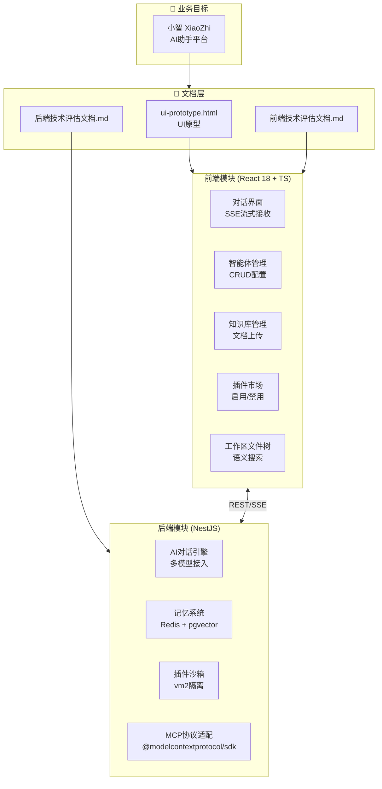
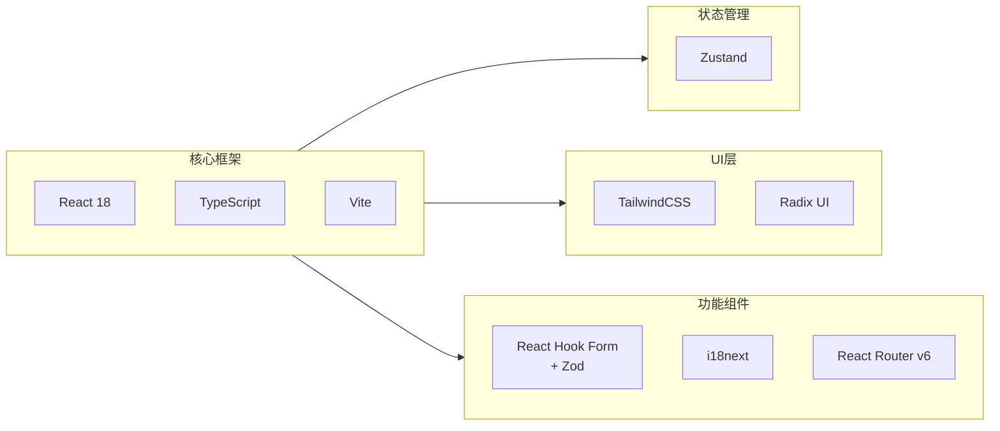
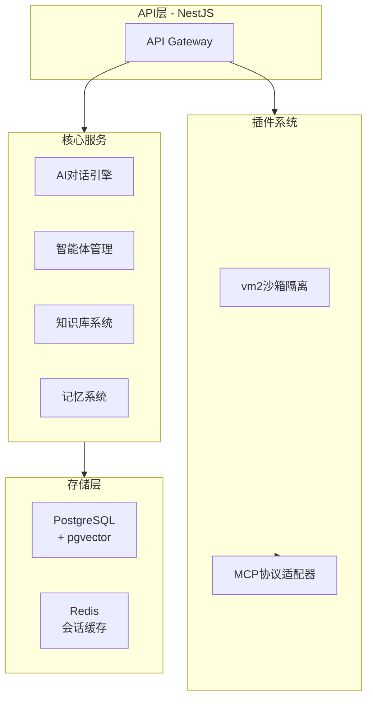

## 1. 高层概览 (TL;DR)

- **影响程度:** 🟢 **中等** - 本次变更为项目初始化阶段，新增三份核心文档，为后续开发奠定基础
- **主要变更:**
  - ✨ 新增 **UI原型页面** (`ui-prototype.html`) - 完整的单页应用原型，展示小智AI助手平台的核心界面交互
  - 📄 新增 **前端技术评估文档** - 明确技术栈选型与分阶段实施计划
  - 📄 新增 **后端技术评估文档** - 定义后端架构方案与MCP协议集成策略

---

## 2. 可视化概览 (架构与逻辑映射)

### 2.1 项目整体架构关系



### 2.2 前端技术栈选型



### 2.3 后端架构设计



---

## 3. 详细变更分析

### 📄 组件一：UI原型页面 (`doc/ui-prototype.html`)

**变更类型:** ✨ 新增文件 (617行)

**功能概述:** 完整的单页应用原型，采用纯HTML/CSS/JS实现，展示小智AI助手平台的核心界面与交互逻辑。

**主要特性:**

| 功能区域 | 实现内容 |
|---------|---------|
| **侧边栏导航** | 可折叠侧边栏、项目选择器、导航菜单（对话/智能体/知识库/插件市场/工作记忆） |
| **对话界面** | 消息列表、用户输入框、SSE流式接收模拟、光标动画 |
| **智能体管理** | 智能体列表、创建/编辑对话框、模型/插件绑定 |
| **知识库管理** | 文档列表、上传功能、搜索筛选 |
| **插件市场** | 插件卡片、分类标签、安装/启用状态 |
| **设置页面** | 主题切换、模型配置、API密钥管理 |

**设计亮点:**
- 🎨 深色主题设计，CSS变量统一管理配色
- 📱 响应式布局，侧边栏可折叠
- ✨ 渐变按钮、阴影效果、平滑过渡动画
- 🔧 Tailwind风格工具类CSS框架

---

### 📄 组件二：前端技术评估文档 (`doc/前端技术评估文档.md`)

**变更类型:** ✨ 新增文件 (150行)

**核心内容:**

#### 技术选型表

| 组件 | 选择 | 理由 |
|------|------|------|
| 框架 | React 18 + TypeScript | 组件化成熟，生态丰富 |
| 状态管理 | Zustand | 轻量、简洁，适合插件化架构 |
| UI框架 | TailwindCSS + Radix UI | 现代化、定制灵活 |
| 路由 | React Router v6 | 方案成熟 |
| 表单 | React Hook Form + Zod | 类型安全验证 |

#### 模块复杂度分级

| 复杂度 | 模块 |
|--------|------|
| **低** | 导航框架、静态页面 |
| **中** | 对话界面、插件市场、知识库管理、智能体管理、设置页面 |
| **高** | 工作区文件树、富文本编辑器、操作审查弹窗、插件化UI扩展 |

#### 分阶段实施计划

| 阶段 | 周期 | 核心产出 |
|------|------|---------|
| P0核心 | 2-3周 | 脚手架、布局组件、对话界面、会话管理 |
| P0扩展 | 2-3周 | 插件市场、智能体管理、知识库UI、操作审查 |
| P1增强 | 2-3周 | 文件树、记忆管理、富文本编辑、MCP接入 |
| P1完善 | 持续 | 插件化UI扩展、高级设置、性能优化、离线支持 |

---

### 📄 组件三：后端技术评估文档 (`doc/后端技术评估文档.md`)

**变更类型:** ✨ 新增文件 (149行)

**核心内容:**

#### 技术选型表

| 组件 | 选择 | 理由 |
|------|------|------|
| 后端框架 | Node.js (NestJS) | 生态丰富，插件系统对接MCP协议方便 |
| 沙箱方案 | Node.js 进程级沙箱 | vm2/SecureVm + 权限控制，放弃Docker |
| 向量库 | 插件化架构 | 默认pgvector，后续可切换Milvus/Chroma/Qdrant |

#### 模块复杂度分级

| 复杂度 | 模块 |
|--------|------|
| **低** | 智能体管理 (CRUD操作) |
| **中** | AI对话引擎、工作区管理、记忆系统、知识库系统、插件沙箱隔离 |
| **高** | 插件系统协议适配、Agent编排引擎 |

#### 向量存储插件接口设计

```typescript
interface IVectorStore {
  name: string;
  upsert(collection: string, embeddings: Embedding[]): Promise<void>;
  search(collection: string, query: number[], topK: number): Promise<SearchResult[]>;
  delete(collection: string, ids: string[]): Promise<void>;
}
```

#### 分阶段实施计划

| 阶段 | 周期 | 核心产出 |
|------|------|---------|
| P0核心 | 4-5周 | AI对话引擎、智能体管理、工作区管理、插件系统基础 |
| P0扩展 | 3-4周 | 知识库系统、记忆系统、操作审查机制 |
| P1增强 | 3-4周 | Agent编排引擎、任务拆分评估、MCP快速接入 |
| P1完善 | 持续 | 沙箱隔离增强、多租户支持、高可用部署 |

---

## 4. 影响与风险评估

### ✅ 无破坏性变更
- 本次变更为纯新增文档，不影响现有代码

### ⚠️ 需关注的技术风险

| 风险领域 | 具体风险 | 建议应对 |
|---------|---------|---------|
| **前端** | 插件化UI动态加载复杂度高 | 前期用条件渲染过渡，后续引入微前端 |
| **前端** | SSE流式性能大流量卡顿 | Web Worker处理解析，主线程只负责渲染 |
| **后端** | MCP协议实现细节复杂 | 优先实现核心工具调用，完整协议放后期 |
| **后端** | vm2沙箱Windows环境兼容性 | 提前POC验证，准备备选方案(isolated-vm) |
| **后端** | 向量检索性能瓶颈 | 前期pgvector轻量方案，后续可迁移Milvus |

### 🧪 测试建议

- [ ] 验证UI原型在各主流浏览器的兼容性
- [ ] 确认技术栈选型与团队技能匹配度
- [ ] 进行MCP SDK接入POC测试
- [ ] 验证vm2沙箱在目标部署环境的可行性

---

## 5. 下一步行动项

| 优先级 | 行动项 | 负责领域 |
|--------|--------|---------|
| 🔴 高 | 细化API接口设计、数据库Schema | 后端 |
| 🔴 高 | 设计Zustand状态管理方案 | 前端 |
| 🔴 高 | 项目初始化：NestJS项目 + 插件化基础架构 | 后端 |
| 🟡 中 | 细化组件库选型评审 | 前端 |
| 🟡 中 | 制定前端项目目录结构 | 前端 |
| 🟡 中 | POC验证：MCP SDK接入测试、vm2沙箱验证 | 后端 |
| 🟢 低 | 输出API接口Mock方案 | 前后端协作 |