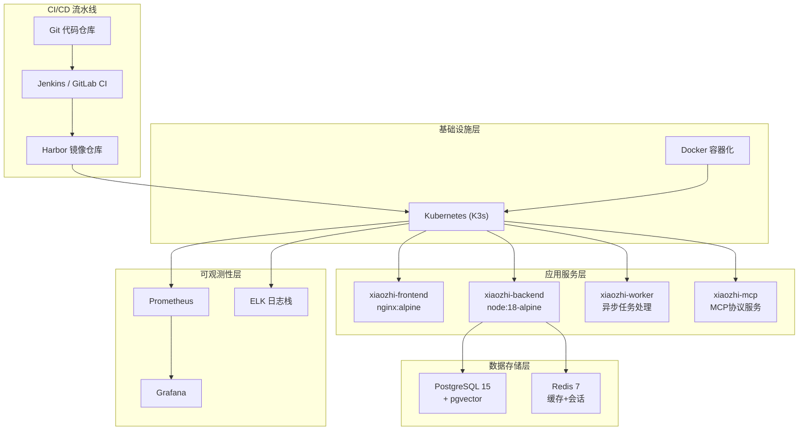
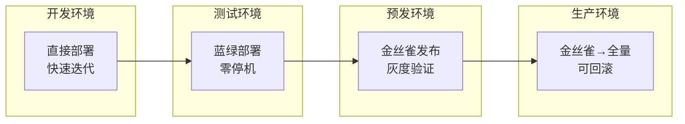

## 1. 高层概览 (TL;DR)

*   **影响程度:** 🟢 **低** - 新增技术文档，无代码变更
*   **核心变更:** 为"小智 XiaoZhi"项目创建了一份完整的 **DevOps 技术评估文档**，涵盖技术选型、CI/CD流水线设计、容器化架构、Kubernetes部署、监控告警、安全设计及分阶段实施计划。

## 2. 可视化概览 (架构与流程图)

### 2.1 技术栈架构关系图

### 2.2 CI/CD 流水线流程图

### 2.3 环境部署策略

## 3. 详细变更分析

### 📄 新增文件: `doc/DevOps技术评估文档.md`

#### 📋 技术选型表

| 组件 | 选择方案 | 选型理由 |
|------|----------|----------|
| 容器化 | Docker | 标准化的应用打包与交付 |
| 编排 | Kubernetes (K3s轻量) | 可扩展、高可用 |
| CI/CD | Jenkins / GitLab CI | 灵活扩展、插件丰富 |
| 代码仓库 | Git | 版本控制 |
| 配置管理 | Ansible | 幂等性好、语法简洁 |
| 监控 | Prometheus + Grafana | 云原生、易集成 |
| 日志 | ELK Stack | 集中日志管理 |
| 镜像仓库 | Harbor | 企业级安全 |

#### 📋 质量门禁配置

| 阶段 | 检查工具 | 通过阈值 |
|------|----------|----------|
| 代码扫描 | SonarQube | 阻断 B/C 级漏洞 |
| 单元测试 | Jest / Mocha | 覆盖率 > 70% |
| 安全扫描 | Trivy / Clair | 无高危漏洞 |
| 集成测试 | Pytest / Supertest | 全部通过 |
| 性能测试 | k6 / JMeter | P99 < 500ms |

#### 📋 Kubernetes 资源配置建议

| 组件 | CPU请求 | CPU限制 | 内存请求 | 内存限制 |
|------|---------|---------|----------|----------|
| frontend | 100m | 500m | 128Mi | 512Mi |
| backend | 200m | 1000m | 256Mi | 1Gi |
| worker | 200m | 1000m | 256Mi | 1Gi |
| mcp | 100m | 500m | 128Mi | 512Mi |

#### 📋 告警规则配置

| 级别 | 触发场景 | 通知方式 |
|------|----------|----------|
| P1 紧急 | 服务不可用 | 电话 + 短信 |
| P2 严重 | 错误率 > 5% | 短信 + 钉钉 |
| P3 警告 | 延迟 > 1s | 邮件 + 钉钉 |
| P4 提示 | 磁盘 > 70% | 邮件 |

#### 📋 分阶段实施计划

| 阶段 | 周期 | 主要任务 |
|------|------|----------|
| **第一阶段** | 1-2周 | 代码仓库搭建、Docker化、CI流水线、日志系统 |
| **第二阶段** | 2-3周 | K8s集群、镜像仓库、CI/CD完善、监控基础 |
| **第三阶段** | 2-3周 | 高可用架构、自动扩缩容、灾备方案、安全加固 |

#### 📋 关键风险识别

| 风险项 | 潜在影响 | 缓解建议 |
|--------|----------|----------|
| K8s学习成本 | 团队上手慢 | 前期用 docker-compose 过渡 |
| 多环境一致性 | 配置漂移 | GitOps 管理基础设施 |
| 插件沙箱安全 | 潜在逃逸风险 | 严格网络策略 + 定期审计 |
| 向量库性能 | 大规模检索慢 | 后期引入专用向量引擎 |

## 4. 影响与风险评估

### ✅ 积极影响
- 📚 为项目提供了完整的 DevOps 实施蓝图
- 🎯 明确了技术选型和架构决策依据
- 📊 定义了清晰的质量门禁和监控指标
- 🗓️ 制定了可落地的分阶段实施计划

### ⚠️ 潜在风险
| 风险类型 | 说明 |
|----------|------|
| **文档落地风险** | 文档仅为规划，实际实施需配套代码和配置 |
| **技术栈复杂度** | K8s + ELK + Prometheus 技术栈对团队要求较高 |
| **资源预估** | 文档未明确硬件资源需求和成本预算 |

### 🧪 建议后续行动
1. ✅ 已规划：制定 Git 分支策略与 Commit 规范
2. ✅ 已规划：输出 Dockerfile 与 docker-compose 开发环境
3. ✅ 已规划：设计 Kubernetes 部署清单
4. ✅ 已规划：制定监控指标与告警规则
5. ✅ 已规划：制定备份与灾备方案
6. 💡 **建议补充**：硬件资源需求评估与成本预算
7. 💡 **建议补充**：团队成员技能培训计划

---

**总结:** 本次变更新增了一份结构完整、内容详实的 DevOps 技术评估文档，为"小智"项目的容器化部署和运维自动化提供了清晰的实施指南。文档涵盖技术选型、流水线设计、安全措施和风险控制，是一份高质量的规划文档。