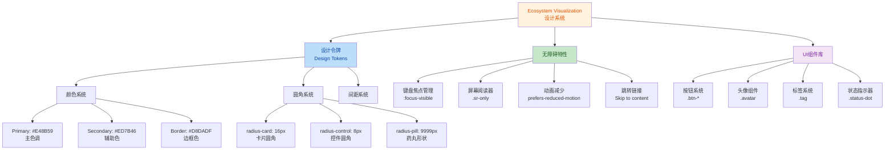
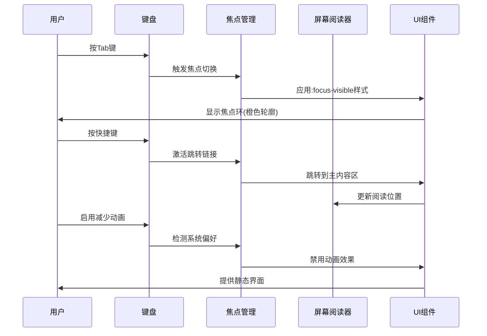
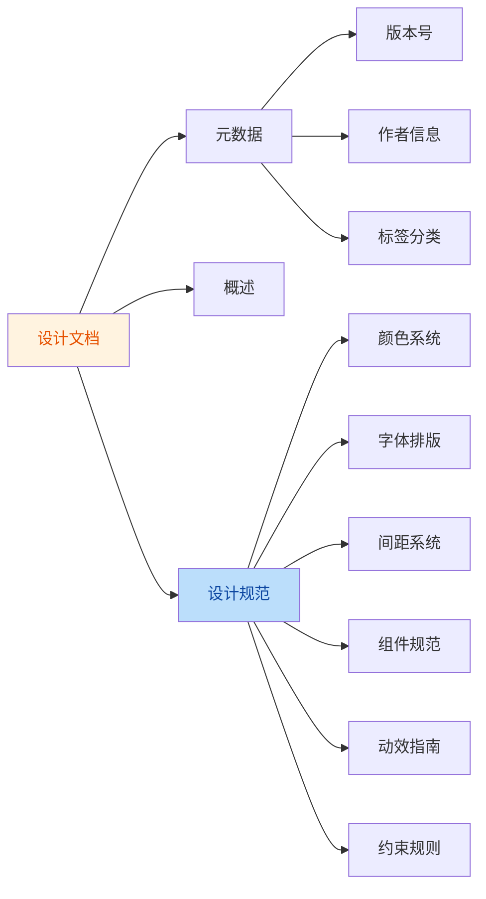

## 1. 高层摘要 (TL;DR)

**影响程度:** 🟢 **中等** - UI设计系统重构与无障碍增强

**核心变更:**
- ✨ **设计系统迁移**: 从紫色主题(#6366f1)迁移至橙棕色主题(#E48B59),引入"Ecosystem Visualization"设计系统
- ♿ **无障碍增强**: 新增键盘导航、屏幕阅读器支持、焦点管理、动画减少等WCAG合规特性
- 🎨 **设计令牌系统化**: 建立可复用的CSS变量体系(圆角、间距、颜色等)
- 🧩 **组件库扩展**: 新增头像、标签、状态指示器等UI组件
- 📝 **设计文档化**: 新增设计规范文档,定义视觉语言和组件标准

---

## 2. 可视化概览 (代码与逻辑映射)

### 设计系统架构变更



### 无障碍交互流程



---

## 3. 详细变更分析

### 3.1 🎨 设计系统重构

**文件:** `doc/ui-prototype.html`

**变更内容:**

#### 颜色主题迁移

| 设计令牌 | 旧值 | 新值 | 用途 |
|---------|------|------|------|
| `--primary` | `#6366f1` (紫色) | `#E48B59` (橙棕色) | 主色调 |
| `--primary-hover` | `#4f46e5` | `#D4763F` | 主色悬停态 |
| `--secondary` | - | `#ED7B46` | 辅助色 |
| `--accent` | - | `#ED7B46` | 强调色 |
| `--border` | `#475569` (深灰) | `#D8DADF` (浅灰) | 边框色 |

**影响范围:** 所有使用主色调的组件(按钮、链接、图标、选中状态)

#### 圆角系统标准化

| CSS类 | 旧值 | 新值 | 应用场景 |
|-------|------|------|----------|
| `.rounded-xl` | `0.75rem` (12px) | `var(--radius-card)` (16px) | 大卡片 |
| `.rounded-2xl` | `1rem` (16px) | `var(--radius-card)` (16px) | 特大卡片 |
| `.rounded-lg` | `0.5rem` (8px) | `var(--radius-control)` (8px) | 按钮/输入框 |
| `.rounded-md` | `0.375rem` (6px) | `var(--radius-control)` (8px) | 小控件 |

**设计意图:** 统一圆角规范,减少随意性,提升视觉一致性

---

### 3.2 ♿ 无障碍功能增强

**文件:** `doc/ui-prototype.html`

#### 核心无障碍特性

| 特性 | 实现方式 | 作用 |
|------|---------|------|
| **键盘焦点管理** | `:focus-visible` + `--focus-ring` 变量 | 为键盘用户提供清晰的焦点指示 |
| **屏幕阅读器支持** | `.sr-only` 类 + `aria-*` 属性 | 隐藏装饰性元素,提供语义化标签 |
| **动画减少** | `@media (prefers-reduced-motion: reduce)` | 尊重用户系统偏好,禁用动画 |
| **跳转链接** | `<a href="#chatArea" class="sr-only">` | 允许键盘用户快速跳过导航 |
| **语义化标签** | `role="navigation"`, `aria-current="page"` | 增强HTML语义结构 |

#### 焦点样式实现

```css
/* 无障碍焦点环 */
:focus-visible { 
  outline: none;
  box-shadow: 0 0 0 2px var(--surface), 0 0 0 4px var(--primary);
}

/* 减少动画偏好 */
@media (prefers-reduced-motion: reduce) {
  *, *::before, *::after {
    animation-duration: 0.01ms !important;
    transition-duration: 0.01ms !important;
  }
}
```

**影响:** 符合WCAG 2.1 AA级标准,提升可访问性评分

---

### 3.3 🧩 UI组件库扩展

**文件:** `doc/ui-prototype.html`

#### 新增组件一览

| 组件类名 | 用途 | 样式特征 |
|---------|------|---------|
| `.logo-icon` | Logo图标 | 渐变背景(主色→辅助色),圆角8px |
| `.avatar` | 用户头像 | 尺寸2.25rem,圆角16px |
| `.avatar-user` | 用户头像样式 | 渐变背景(绿→青) |
| `.tag` | 标签/徽章 | 药丸形状,小字号(12px) |
| `.tag-primary` | 主色标签 | 半透明橙色背景 |
| `.tag-success` | 成功标签 | 半透明绿色背景 |
| `.tag-warning` | 警告标签 | 半透明橙色背景 |
| `.status-dot` | 状态指示点 | 尺寸0.5rem,圆形 |
| `.status-success` | 成功状态 | 绿色(#22c55e) |
| `.status-warning` | 警告状态 | 橙色(#f59e0b) |
| `.status-error` | 错误状态 | 红色(#ef4444) |

#### 按钮系统优化

**变更前后对比:**

| 特性 | 旧实现 | 新实现 | 改进点 |
|------|--------|--------|--------|
| **背景** | 渐变(`linear-gradient`) | 纯色(`var(--primary)`) | 性能优化,减少重绘 |
| **悬停效果** | `translateY(-1px)` + 阴影增强 | 背景色变深 + `scale(0.98)` | 更克制的交互反馈 |
| **过渡动画** | `all 0.2s ease` | 分属性过渡(0.15s) | 更精细的动画控制 |
| **圆角** | 硬编码值 | `var(--radius-control)` | 统一设计令牌 |

---

### 3.4 📝 设计文档新增

**文件:** `doc/ecosystem-visualization-DESIGN.md` (新增)

**文档结构:**



**关键设计约束:**

| 约束类型 | 规则说明 |
|---------|---------|
| **颜色对比度** | 保持背景、表面、文本、边框的对比度模式 |
| **字体使用** | 标题用Inter,正文用Inter,标签用JetBrains Mono |
| **布局保持** | 不替换独特的源结构为通用SaaS布局 |
| **动效克制** | 保留蒙版揭示、交错入场、悬停提升等微妙动效 |
| **WebGL性能** | 将特效作为内容背后的支持层,保持响应性 |

---

### 3.5 🔧 HTML结构优化

**文件:** `doc/ui-prototype.html`

#### 侧边栏重构

**变更点:**
- Logo图标从硬编码样式改为`.logo-icon`类
- 折叠按钮位置调整(从左侧移至右侧)
- 导航链接添加`role="menuitem"`和`tabindex="0"`
- SVG图标添加`aria-hidden="true"`

**无障碍改进:**
```html
<!-- 跳转链接 -->
<a href="#chatArea" class="sr-only focus:not-sr-only">
  跳转到主内容
</a>

<!-- 语义化导航 -->
<nav role="navigation" aria-label="主导航">
  <a href="#chat" role="menuitem" aria-current="page" tabindex="0">
    对话
  </a>
</nav>
```

---

## 4. 影响与风险评估

### ⚠️ 潜在风险

| 风险类型 | 描述 | 缓解措施 |
|---------|------|---------|
| **视觉回归** | 颜色主题变更可能影响品牌识别度 | 保留设计文档,便于回滚 |
| **样式冲突** | CSS变量重命名可能影响现有组件 | 逐步迁移,保持向后兼容 |
| **性能影响** | 新增动画和过渡可能增加渲染负担 | 使用GPU加速属性,限制动画时长 |
| **浏览器兼容** | `:focus-visible`在旧浏览器不支持 | 提供降级方案 |

### ✅ 测试建议

**视觉测试:**
- 🎨 验证新颜色主题在不同显示器上的表现
- 📱 测试响应式布局在移动端的圆角和间距
- 🌙 检查深色模式下的颜色对比度

**无障碍测试:**
- ⌨️ 使用键盘完整导航所有交互元素
- 🔊 使用屏幕阅读器测试语义化标签
- 🎯 验证焦点环在所有组件上的可见性
- ⚡ 测试动画减少模式下的界面表现

**性能测试:**
- 📊 测量CSS文件大小变化(预计增加约15%)
- ⏱️ 测试动画和过渡的性能开销
- 🖥️ 验证在低端设备上的渲染流畅度

**兼容性测试:**
- 🌐 测试主流浏览器(Chrome, Firefox, Safari, Edge)
- 📱 测试iOS Safari和Android Chrome
- 🖱️ 验证触摸设备上的交互反馈

---

## 5. 总结

本次变更是一次**系统性的设计系统升级**,核心价值在于:

1. **设计规范化**: 建立可复用的设计令牌体系,减少随意性
2. **无障碍合规**: 符合WCAG标准,扩大用户覆盖范围
3. **组件化思维**: 构建可维护的UI组件库,提升开发效率
4. **文档化沉淀**: 通过设计文档确保设计一致性

**建议下一步:**
- 建立组件库文档(如Storybook)
- 添加单元测试验证样式输出
- 创建设计令牌的TypeScript类型定义
- 监控真实用户的无障碍使用数据