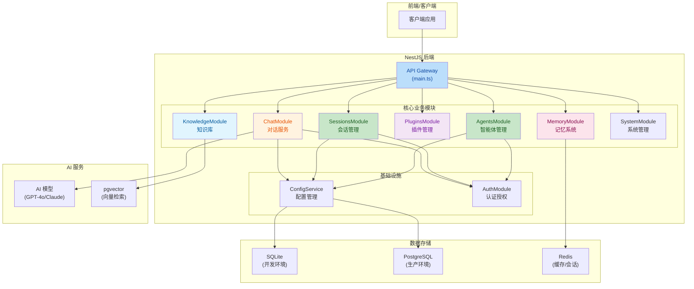
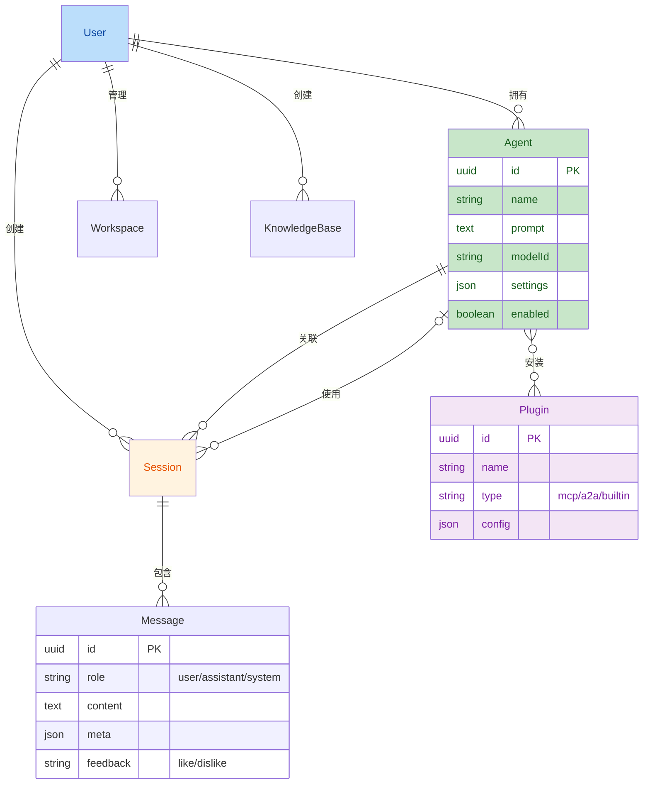

## 1. 高层摘要 (TL;DR)

- **影响级别**: 🚀 **高** - 这是一个全新的后端项目初始化，构建了完整的 AI 助手平台后端基础设施。
- **核心变更**:
  - ✨ 初始化 **NestJS 后端项目**，包含完整的项目配置和构建工具链
  - 🗄️ 设计并实现 **7 个数据库实体**（User、Agent、Session、Message、Plugin、KnowledgeBase、Workspace）
  - 📦 创建 **8 个业务模块**，覆盖智能体管理、对话、插件、知识库、记忆系统等核心功能
  - 📝 编写完整的 **API 接口设计文档** 和技术评估文档
  - ⚙️ 配置 **SQLite/PostgreSQL 双数据库支持** 和 Docker 开发环境

---

## 2. 可视化概览 (代码与逻辑地图)

### 2.1 系统架构图



### 2.2 实体关系图



### 2.3 API 模块与端点映射

| 模块 | Controller | 核心端点 | 功能描述 |
|------|------------|----------|----------|
| 智能体管理 | `AgentsController` | `POST/GET/PUT/DELETE /agents` | 智能体 CRUD |
| 会话管理 | `SessionsController` | `POST/GET/PUT/DELETE /sessions` | 会话生命周期管理 |
| 对话服务 | `ChatController` | `POST /chat`, `SSE /chat/:id/stream` | 消息发送与流式响应 |
| 插件管理 | `PluginsController` | `POST/GET/PATCH/DELETE /plugins` | 插件安装与配置 |
| 知识库 | `KnowledgeController` | `POST/GET/PUT/DELETE /knowledge-bases` | 知识库管理与 RAG 检索 |
| 记忆系统 | `MemoryController` | `POST /memory/short-term`, `/long-term` | 短时/长时记忆管理 |
| 系统管理 | `SystemController` | `GET /system/health`, `/models`, `/stats` | 健康检查与系统信息 |

---

## 3. 详细变更分析

### 3.1 🗂️ 项目配置与基础设施

**变更内容**:
- 新增 `package.json` 定义项目依赖和脚本命令
- 新增 `config.yaml` 统一管理应用配置（数据库、Redis、JWT、模型列表）
- 新增 `docker-compose.yml` 配置 PostgreSQL (pgvector) 和 Redis 服务
- 更新 `.gitignore` 忽略 `node_modules` 目录

**配置文件关键参数**:

| 配置项 | 值 | 说明 |
|--------|-----|------|
| `database.type` | `sqlite` | 默认使用 SQLite 开发 |
| `app.port` | `3000` | 服务端口 |
| `app.jwtSecret` | `xiaozhi-super-secret-key...` | JWT 密钥（生产需更换） |
| `models.default` | `gpt-4o-mini` | 默认 AI 模型 |
| `vector.dimension` | `1536` | 向量维度 |

---

### 3.2 🗄️ 数据库实体设计

**新增 7 个 TypeORM 实体**，位于 `src/entities/` 目录：

| 实体 | 表名 | 核心字段 | 关系 |
|------|------|----------|------|
| **User** | `users` | username, email, passwordHash, role | 1:N → Agent, Session, Workspace, KnowledgeBase |
| **Agent** | `agents` | name, modelId, prompt, settings, enabled | N:1 → User, N:N → Plugin |
| **Session** | `sessions` | title, lastMessageAt, workspaceId | N:1 → User, Agent; 1:N → Message |
| **Message** | `messages` | role, content, meta, feedback | N:1 → Session |
| **Plugin** | `plugins` | name, type, config, enabled | N:N → Agent |
| **KnowledgeBase** | `knowledge_bases` | name, description, settings | N:1 → User |
| **Workspace** | `workspaces` | name, rootPath | N:1 → User |

**设计亮点**:
- 所有实体使用 **UUID 主键**
- 支持 **软删除**（`deletedAt` 字段）
- 自动维护 **创建/更新时间戳**
- Agent 与 Plugin 采用 **多对多关系**（灵活配置）

---

### 3.3 📦 业务模块实现

#### 3.3.1 智能体管理模块

**核心功能**:
- `create()` - 创建智能体，绑定用户 ID
- `findAll()` - 分页查询，支持关键词搜索（ILIKE 模糊匹配）
- `findOne()` - 获取详情，自动加载关联插件
- `update()` / `remove()` - 更新与软删除

**关键代码逻辑** (Source: `agents.service.ts`):
```typescript
// 关键词搜索使用 ILIKE 实现模糊匹配
query.andWhere('(agent.name ILIKE :keyword OR agent.description ILIKE :keyword)', {
  keyword: `%${keyword}%`,
});
```

#### 3.3.2 对话服务模块

**核心功能**:
- `sendMessage()` - 发送消息，自动保存用户消息和模拟 AI 响应
- `streamChat()` - SSE 流式对话（当前为模拟实现）
- `feedback()` - 消息点赞/点踩反馈

**待完善项**:
- ⚠️ SSE 流式响应目前返回模拟数据，需接入真实 AI 模型
- ⚠️ 中断生成功能未实现

#### 3.3.3 记忆系统模块

**设计架构**:
- **短时记忆**: 基于会话 的临时记忆
- **长时记忆**: 基于 Agent 的持久化记忆，支持向量检索
- **记忆整合**: `consolidate()` 方法将短时记忆总结后写入长时记忆

---

### 3.4 📝 文档变更

新增完整的技术文档：

| 文档路径 | 内容概述 |
|----------|----------|
| `doc/backend/后端API接口设计.md` | 完整的 RESTful API 设计规范 |
| `doc/backend/后端技术评估文档.md` | 技术选型分析 |
| `doc/backend/后端数据库Schema设计.md` | 数据库表结构设计 |
| `doc/backend/后端项目初始化指南.md` | 项目启动指南 |

---

## 4. 影响与风险评估

### 4.1 ⚠️ 待完善功能

| 模块 | 待办事项 | 优先级 |
|------|----------|--------|
| **认证模块** | JWT 认证未完整实现，当前使用硬编码 `default-user-id` | 🔴 高 |
| **对话服务** | AI 模型调用未接入，返回模拟响应 | 🔴 高 |
| **SSE 流式** | 流式对话为模拟实现 | 🟡 中 |
| **中断生成** | `stopGeneration()` 未实现 | 🟡 中 |
| **向量检索** | pgvector 集成待完善 | 🟡 中 |

### 4.2 🔒 安全建议

1. **JWT 密钥**: 生产环境必须更换 `config.yaml` 中的 `jwtSecret`
2. **密码存储**: 当前仅定义 `passwordHash` 字段，需实现 bcrypt 加密
3. **认证中间件**: 需完善 AuthModule，实现完整的 JWT 验证流程

### 4.3 🧪 测试建议

- **单元测试**: 验证各 Service 层的 CRUD 操作正确性
- **集成测试**: 测试 Agent 与 Plugin 的多对多关系
- **边界测试**: 测试空列表、无效 ID、权限校验等边界场景
- **数据库切换**: 验证 SQLite → PostgreSQL 迁移的兼容性

---

## 5. 依赖清单

### 核心依赖

| 包名 | 版本 | 用途 |
|------|------|------|
| `@nestjs/core` | ^10.3.0 | NestJS 核心 |
| `@nestjs/typeorm` | ^10.0.2 | TypeORM 集成 |
| `@nestjs/swagger` | ^7.3.0 | API 文档生成 |
| `@nestjs/jwt` | ^10.2.0 | JWT 认证 |
| `typeorm` | ^0.3.20 | ORM 框架 |
| `pg` | ^8.11.3 | PostgreSQL 驱动 |
| `pgvector` | ^0.1.8 | 向量扩展 |
| `ioredis` | ^5.3.2 | Redis 客户端 |

---

## 6. 快速启动指南

```bash
# 1. 安装依赖
cd xiaozhi-backend && pnpm install

# 2. 启动数据库服务（可选，用于 PostgreSQL）
docker-compose up -d

# 3. 启动开发服务器
pnpm start:dev

# 4. 访问 API 文档
# http://localhost:3000/api/docs
```