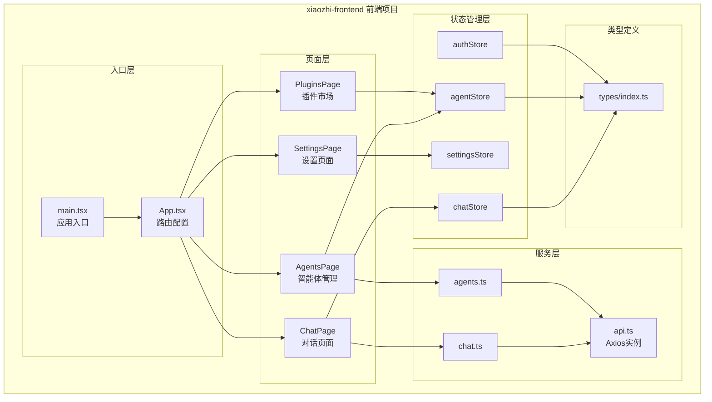
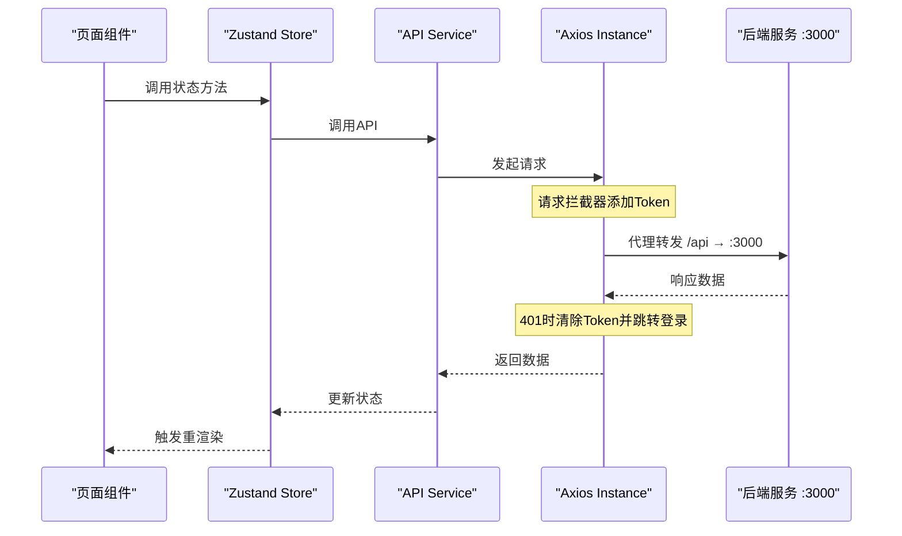
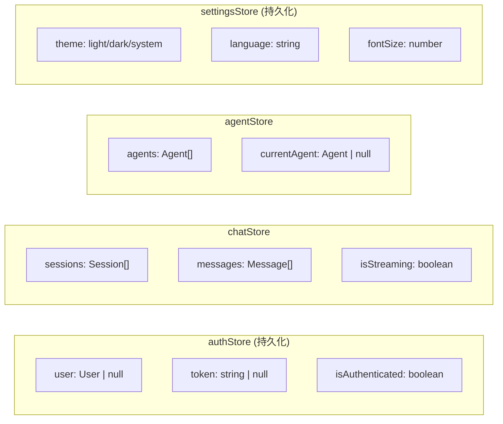

## 1. 高层概览 (TL;DR)

- **影响范围：高** - 这是一个全新的前端项目初始化，创建了完整的 `xiaozhi-frontend` 项目骨架。
- **核心变更：**
  - ✨ 初始化 React 18 + TypeScript + Vite 5 项目结构
  - 📦 集成 Zustand 状态管理、TailwindCSS + Radix UI 组件库
  - 🏗️ 搭建 4 个核心页面（Chat、Agents、Plugins、Settings）的路由框架
  - 🔧 配置 API 服务层与代理转发
  - 📝 添加详细的项目文档与初始化指南

---

## 2. 可视化概览 (代码与逻辑映射)

### 2.1 项目架构图



### 2.2 API 请求流程



---

## 3. 详细变更分析

### 3.1 📁 项目配置与依赖

| 文件 | 用途 | 关键配置 |
|------|------|----------|
| `package.json` | 项目依赖定义 | React 18、Vite 5、Zustand 4、TailwindCSS 3 |
| `vite.config.ts` | 构建配置 | 端口 3001、API代理到 :3000、`@`路径别名 |
| `tsconfig.json` | TypeScript配置 | strict模式、`@/*`路径映射 |
| `tailwind.config.js` | 样式配置 | 暗色模式、自定义颜色主题 |
| `postcss.config.js` | CSS处理 | TailwindCSS + Autoprefixer |

**核心依赖清单：**

| 类别 | 包名 | 版本 |
|------|------|------|
| 框架 | react, react-dom | ^18.2.0 |
| 构建 | vite, @vitejs/plugin-react | ^5.1.0, ^4.2.0 |
| 状态 | zustand | ^4.5.7 |
| UI | @radix-ui/* (10+组件) | ^1.x |
| 样式 | tailwindcss, clsx, tailwind-merge | ^3.4.0, ^2.1.1, ^2.6.1 |
| 路由 | react-router-dom | ^6.30.4 |
| HTTP | axios | ^1.18.1 |
| 表单 | react-hook-form, zod | ^7.81.0, ^3.25.76 |
| 国际化 | i18next, react-i18next | ^23.16.8, ^14.1.3 |
| 动画 | framer-motion | ^11.18.2 |

---

### 3.2 🏠 入口与路由

**`main.tsx`** - 应用入口
- 使用 `BrowserRouter` 包裹应用
- 引入全局样式 `./styles/index.css`

**`App.tsx`** - 路由配置
- 根路径 `/` 重定向到 `/chat`
- 定义 4 个页面路由

| 路由 | 页面组件 | 说明 |
|------|----------|------|
| `/chat` | `ChatPage` | 核心对话界面 |
| `/agents` | `AgentsPage` | 智能体管理 |
| `/plugins` | `PluginsPage` | 插件市场 |
| `/settings` | `SettingsPage` | 系统设置 |

---

### 3.3 📄 页面组件

#### ChatPage（对话页面）- 核心功能页面

**功能实现：**
- 消息列表展示（用户/AI消息气泡）
- 输入框 + 发送按钮
- 流式响应状态控制（`isStreaming`）
- Enter键快捷发送

**关键代码逻辑：**
```typescript
// 消息发送流程
handleSend() → addMessage() → setInput('')
// 消息渲染区分
msg.role === 'user' ? flex-row-reverse : ''
```

#### 其他页面（占位页面）

| 页面 | 状态 | 说明 |
|------|------|------|
| `AgentsPage` | 🚧 开发中 | 智能体管理页面骨架 |
| `PluginsPage` | 🚧 开发中 | 插件市场页面骨架 |
| `SettingsPage` | 🚧 开发中 | 设置页面骨架 |

---

### 3.4 🗃️ 状态管理

| Store | 文件 | 核心状态 | 持久化 |
|-------|------|----------|--------|
| `authStore` | `authStore.ts` | user, token, isAuthenticated | ✅ localStorage |
| `chatStore` | `chatStore.ts` | sessions, messages, isStreaming | ❌ |
| `agentStore` | `agentStore.ts` | agents, currentAgent | ❌ |
| `settingsStore` | `settingsStore.ts` | theme, language, fontSize | ✅ localStorage |

**状态结构图：**



---

### 3.5 🔌 API 服务层

#### `api.ts` - Axios 实例配置

| 配置项 | 值 |
|--------|-----|
| baseURL | `/api` |
| timeout | 30000ms |
| 请求拦截 | 自动添加 `Authorization: Bearer ${token}` |
| 响应拦截 | 401时清除Token并跳转 `/login` |

#### `agents.ts` - 智能体 API

| 方法 | 端点 | 说明 |
|------|------|------|
| `list()` | `GET /agents` | 分页列表查询 |
| `get(id)` | `GET /agents/:id` | 获取详情 |
| `create(data)` | `POST /agents` | 创建智能体 |
| `update(id, data)` | `PUT /agents/:id` | 更新智能体 |
| `delete(id)` | `DELETE /agents/:id` | 删除智能体 |
| `bindPlugins(id, pluginIds)` | `POST /agents/:id/plugins` | 绑定插件 |

#### `chat.ts` - 对话 API

| 方法 | 端点 | 说明 |
|------|------|------|
| `createSession(data)` | `POST /sessions` | 创建会话 |
| `listSessions(params)` | `GET /sessions` | 会话列表 |
| `sendMessage(sessionId, message)` | `POST /chat` | 发送消息 |
| `stopGeneration(sessionId)` | `POST /chat/:sessionId/stop` | 停止生成 |
| `feedback(messageId, rating)` | `POST /chat/messages/:id/feedback` | 消息反馈 |
| `streamChat(sessionId, message)` | EventSource | SSE流式对话 |

---

### 3.6 📐 TypeScript 类型定义

**核心类型一览：**

| 类型 | 用途 | 关键字段 |
|------|------|----------|
| `User` | 用户信息 | id, username, email, role |
| `Agent` | 智能体 | id, name, modelId, prompt, plugins[] |
| `Plugin` | 插件 | id, name, type(mcp/a2a/builtin), config |
| `Session` | 会话 | id, title, agentId, workspaceId |
| `Message` | 消息 | id, sessionId, role, content, feedback |
| `Workspace` | 工作区 | id, name, rootPath |
| `KnowledgeBase` | 知识库 | id, name, settings |
| `Document` | 文档 | id, knowledgeBaseId, status |

---

### 3.7 🎨 样式系统

**CSS 变量主题：**

| 变量 | 值 | 用途 |
|------|-----|------|
| `--primary` | `#6366f1` | 主色调（紫蓝色） |
| `--primary-hover` | `#4f46e5` | 主色悬停态 |
| `--surface` | `#0f172a` | 背景色（深蓝） |
| `--surface-light` | `#1e293b` | 卡片背景 |
| `--border` | `#475569` | 边框色 |
| `--text-primary` | `#f8fafc` | 主文字色 |
| `--text-secondary` | `#94a3b8` | 次要文字 |

---

### 3.8 📝 文档更新

| 文件 | 内容 |
|------|------|
| `README.md` | 项目介绍、技术栈、快速开始、开发指南 |
| `前端项目初始化指南.md` | 详细的技术选型理由、目录结构、Store设计、Mock方案 |

---

### 3.9 ⚙️ 其他配置

**`.gitignore` 更新：**
```diff
+ xiaozhi-frontend/node_modules/*
```

---

## 4. 影响与风险评估

### ⚠️ 潜在风险

| 风险点 | 说明 | 建议 |
|--------|------|------|
| 🔴 SSE流式实现 | `streamChat` 使用 EventSource，但 token 通过 URL 传递存在安全隐患 | 建议改用 POST + header 认证 |
| 🟡 页面占位 | Agents/Plugins/Settings 页面仅为骨架 | 需后续补充完整功能 |
| 🟡 缺少布局组件 | 无侧边栏/顶栏等布局组件 | 建议添加 `components/layout/` |

### ✅ 测试建议

1. **路由测试**：验证所有路由跳转和重定向正常
2. **API代理测试**：确认 `/api` 正确代理到后端 `:3000`
3. **状态持久化**：刷新页面后验证 `authStore` 和 `settingsStore` 数据保留
4. **Chat页面**：测试消息发送、气泡渲染、Enter快捷键
5. **Token机制**：验证401响应时自动跳转登录页

---

## 5. 待完成事项 (TODO)

根据 README.md 标注：

- [ ] 完善对话页面 SSE 流式接收
- [ ] 智能体管理页面完整实现
- [ ] 插件市场页面完整实现
- [ ] 知识库页面上传组件
- [ ] 设置页面主题切换功能
- [ ] i18n 国际化配置
- [ ] 单元测试框架搭建