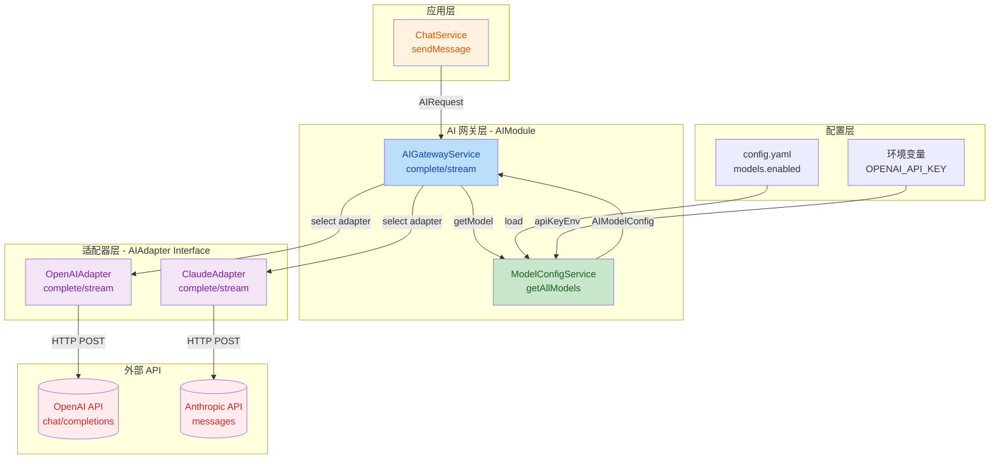
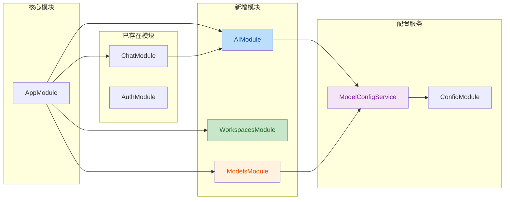
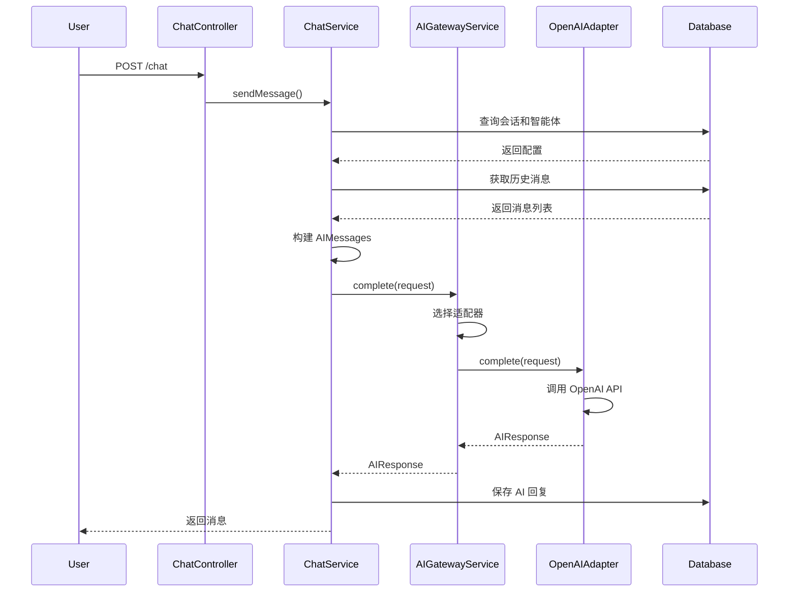

## 1. 高层概览 (TL;DR)

**影响等级：高** - 本次变更实现了核心 AI 能力的集成，新增了完整的 AI 模型网关系统和工作区管理功能，使系统从原型阶段进入可实际运行阶段。

**关键变更：**
- ✨ **AI 网关系统**：新增统一的 AI 模型网关，支持 OpenAI 和 Claude 双提供商适配
- 🏗️ **工作区模块**：新增工作区管理功能，支持文件树浏览和搜索
- 🎛️ **模型管理 API**：新增模型配置的 REST API，支持动态管理模型
- 🔧 **配置系统升级**：重构配置系统，支持环境变量注入和多模型配置
- 💬 **Chat 服务集成**：Chat 服务从模拟响应升级为真实 AI 调用

---

## 2. 可视化概览（代码与逻辑映射）

### 2.1 AI 网关架构流程



### 2.2 模块依赖关系图



### 2.3 Chat 服务与 AI 集成流程



---

## 3. 详细变更分析

### 3.1 AI 模块

#### 📁 文件清单

| 文件路径 | 类型 | 说明 |
|---------|------|------|
| `src/modules/ai/ai.module.ts` | 新增 | AI 模块定义 |
| `src/modules/ai/ai-gateway.service.ts` | 新增 | AI 网关服务，统一模型调用入口 |
| `src/modules/ai/ai-adapter.interface.ts` | 新增 | AI 适配器接口定义 |
| `src/modules/ai/adapters/openai.adapter.ts` | 新增 | OpenAI API 适配器 |
| `src/modules/ai/adapters/claude.adapter.ts` | 新增 | Claude API 适配器 |

#### 🔧 核心功能

**AIGatewayService** (Source: `ai-gateway.service.ts`)
- **初始化适配器**：根据配置动态创建模型适配器实例
- **统一接口**：提供 `complete()` 和 `stream()` 两个核心方法
- **模型管理**：支持查询可用模型列表和模型配置
- **错误处理**：自动跳过无 API Key 的模型，记录警告日志

**AIAdapter 接口定义**：

| 接口 | 方法签名 | 说明 |
|------|---------|------|
| `AIRequest` | `{model, messages, stream?, temperature?, maxTokens?}` | AI 请求结构 |
| `AIResponse` | `{content, model, usage?}` | AI 响应结构 |
| `AIStreamResponse` | `{content, done}` | 流式响应结构 |
| `AIAdapter` | `complete(request)` / `stream(request)` | 适配器接口 |

**OpenAIAdapter 特性**：
- 支持 `baseURL` 自定义（兼容 OpenAI 兼容 API）
- 实现完整的 SSE 流式响应解析
- 自动处理 API 错误和异常

**ClaudeAdapter 特性**：
- 正确处理 Claude API 的 `system` 消息分离
- 使用 `x-api-key` 和 `anthropic-version` 头部
- 解析 Claude 特有的流式事件类型

---

### 3.2 工作区模块

#### 📁 文件清单

| 文件路径 | 类型 | 说明 |
|---------|------|------|
| `src/modules/workspaces/workspaces.module.ts` | 新增 | 工作区模块定义 |
| `src/modules/workspaces/workspaces.service.ts` | 新增 | 工作区业务逻辑 |
| `src/modules/workspaces/workspaces.controller.ts` | 新增 | 工作区 REST API |

#### 🎯 核心功能

**WorkspacesService** 提供以下方法：

| 方法 | 功能 | 说明 |
|------|------|------|
| `create()` | 创建工作区 | 关联用户 ID |
| `findAll()` | 查询用户工作区列表 | 按创建时间倒序 |
| `findOne()` | 查询单个工作区 | 验证用户权限 |
| `update()` | 更新工作区 | 支持部分更新 |
| `remove()` | 删除工作区 | 软删除 |
| `getFileTree()` | 获取文件树 | 遍历指定路径 |
| `search()` | 搜索文件 | TODO 待实现 |

**WorkspacesController API 端点**：

| 方法 | 路径 | 功能 |
|------|------|------|
| POST | `/workspaces` | 创建工作区 |
| GET | `/workspaces` | 获取工作区列表 |
| GET | `/workspaces/:id` | 获取工作区详情 |
| PUT | `/workspaces/:id` | 更新工作区 |
| DELETE | `/workspaces/:id` | 删除工作区 |
| GET | `/workspaces/:id/files` | 获取文件树 |
| GET | `/workspaces/:id/search` | 搜索文件 |

---

### 3.3 模型管理模块

#### 📁 文件清单

| 文件路径 | 类型 | 说明 |
|---------|------|------|
| `src/modules/models/models.module.ts` | 新增 | 模型管理模块 |
| `src/modules/models/models.controller.ts` | 新增 | 模型管理 REST API |

#### 🎛️ ModelsController API 端点

| 方法 | 路径 | 功能 | 特殊逻辑 |
|------|------|------|---------|
| GET | `/models` | 获取所有模型 | 返回 `hasApiKey` 标志 |
| GET | `/models/enabled` | 获取已启用模型 | 仅返回基础信息 |
| GET | `/models/:id` | 获取模型详情 | 包含完整配置 |
| POST | `/models` | 添加新模型 | 支持 `apiKeyEnv` 自动注入 |
| PUT | `/models/:id` | 更新模型配置 | 支持部分更新 |
| DELETE | `/models/:id` | 删除模型 | - |
| POST | `/models/:id/enable` | 启用模型 | - |
| POST | `/models/:id/disable` | 禁用模型 | - |

---

### 3.4 配置系统升级

#### 📁 文件清单

| 文件路径 | 类型 | 说明 |
|---------|------|------|
| `src/config/app-config.interface.ts` | 新增 | 应用配置接口定义 |
| `src/config/model-config.service.ts` | 新增 | 模型配置管理服务 |

#### 📊 配置结构定义

**AIModelConfig 接口**：

| 字段 | 类型 | 必填 | 说明 |
|------|------|------|------|
| `id` | string | ✅ | 模型唯一标识 |
| `name` | string | ✅ | 模型显示名称 |
| `provider` | 'openai' \| 'anthropic' \| 'custom' | ✅ | 提供商类型 |
| `apiKey` | string | ❌ | API 密钥（直接配置） |
| `apiKeyEnv` | string | ❌ | 环境变量名（推荐） |
| `baseURL` | string | ✅ | API 基础 URL |
| `maxTokens` | number | ❌ | 最大令牌数 |
| `temperature` | number | ❌ | 温度参数 |
| `enabled` | boolean | ✅ | 是否启用 |

**ModelConfigService 核心方法**：

| 方法 | 返回类型 | 说明 |
|------|---------|------|
| `getModel(id)` | `AIModelConfig \| undefined` | 获取单个模型配置 |
| `getDefaultModel()` | `AIModelConfig \| undefined` | 获取默认模型 |
| `getAllModels()` | `AIModelConfig[]` | 获取所有模型 |
| `getEnabledModels()` | `AIModelConfig[]` | 获取已启用模型 |
| `addModel(config)` | `void` | 添加模型 |
| `updateModel(id, updates)` | `void` | 更新模型配置 |
| `removeModel(id)` | `void` | 删除模型 |

---

### 3.5 Chat 服务集成 AI

#### 📝 变更详情 (Source: `chat.service.ts`)

**主要变更**：
1. **注入 AIGatewayService**：新增依赖注入
2. **构建历史上下文**：从数据库加载历史消息并转换为 `AIMessage[]`
3. **智能体配置集成**：根据智能体配置选择模型和系统提示词
4. **真实 AI 调用**：调用 `aiGateway.complete()` 获取响应
5. **错误处理**：捕获 AI 调用失败，返回友好错误消息

**关键代码片段**：

```typescript
// 构建历史上下文
const historyMessages = await this.getMessages(sessionId, userId);
const aiMessages: AIMessage[] = historyMessages.map(m => ({
  role: m.role as 'user' | 'assistant' | 'system',
  content: m.content,
}));

// 添加当前用户消息
aiMessages.push({ role: 'user', content });

// 获取智能体配置
if (session.agentId) {
  const agent = await this.agentRepository.findOne({ where: { id: session.agentId } });
  if (agent) {
    model = agent.modelId || model;
    if (agent.prompt) {
      aiMessages.unshift({ role: 'system', content: agent.prompt });
    }
  }
}

// 调用 AI
const response = await this.aiGateway.complete({
  model,
  messages: aiMessages,
  temperature: 0.7,
});
```

---

### 3.6 配置文件更新

#### 📝 config.yaml 变更

**新增模型配置结构**：

| 模型 ID | 提供商 | API Key 来源 | Base URL | Max Tokens |
|---------|--------|-------------|----------|------------|
| `gpt-4o-mini` | OpenAI | `OPENAI_API_KEY` | `https://api.openai.com/v1` | 4096 |
| `gpt-4o` | OpenAI | `OPENAI_API_KEY` | `https://api.openai.com/v1` | 8192 |
| `claude-3-5-sonnet` | Anthropic | `ANTHROPIC_API_KEY` | `https://api.anthropic.com/v1` | 8192 |
| `qwen35-35b-a3b-fp8` | OpenAI | 直接配置 | `https://eisapi.byd.com/open-api/1.0/llm/v1/qwen35-35b-a3b-fp8` | 262144 |

**默认模型变更**：从 `gpt-4o-mini` 改为 `qwen35-35b-a3b-fp8`

---

### 3.7 文档更新

#### 📝 README.md 变更

**新增内容**：
- 模块状态表格（9 个模块全部标记为 ✅ 完成）
- POC 验证文档链接
- API 使用示例（登录、创建智能体、发送消息）
- 下一步计划清单

**更新内容**：
- 数据库说明：明确支持 SQLite（开发）和 PostgreSQL（生产）
- 安装步骤：简化为 3 步（安装依赖、配置数据库、启动）
- 目录结构：补充完整模块列表

---

## 4. 影响与风险评估

### ⚠️ 潜在风险

#### 1. **安全风险**
- **API Key 管理不完善**：`config.yaml` 中直接硬编码了 Qwen 的 API Key（第 63 行）
- **建议**：移除硬编码的 API Key，仅使用环境变量方式

#### 2. **功能不完整**
- **文件搜索未实现**：`WorkspacesService.search()` 方法标记为 TODO
- **流式对话未集成**：`ChatStreamService` 仍返回模拟数据，未调用真实 AI

#### 3. **性能问题**
- **缺少缓存机制**：每次请求都直接调用外部 API，无缓存层
- **建议**：引入 Redis 缓存相似请求的响应

#### 4. **错误处理不足**
- **缺少重试机制**：API 调用失败时无自动重试
- **缺少降级策略**：主模型失败时无备用模型切换逻辑

### 🔥 破坏性变更

| 变更类型 | 影响范围 | 说明 |
|---------|---------|------|
| 配置结构变更 | `config.yaml` | 模型配置从简单列表改为详细对象结构 |
| Chat 服务行为变更 | `/chat` 端点 | 从模拟响应改为真实 AI 调用，响应时间增加 |

### ✅ 测试建议

#### 功能测试
1. **AI 调用测试**：
   - 测试 OpenAI 和 Claude 两个提供商的调用
   - 测试流式响应是否正常解析
   - 测试错误场景（无效 API Key、网络超时）

2. **工作区测试**：
   - 测试文件树浏览功能
   - 测试跨目录访问安全性
   - 测试并发访问场景

3. **模型管理测试**：
   - 测试动态添加/删除模型
   - 测试环境变量注入逻辑
   - 测试模型启用/禁用功能

#### 集成测试
1. **端到端对话流程**：
   - 创建智能体 → 创建会话 → 发送消息 → 验证响应
   - 测试历史消息上下文是否正确构建
   - 测试智能体配置（模型、提示词）是否生效

2. **配置加载测试**：
   - 测试缺失环境变量时的错误处理
   - 测试配置文件热更新（如果支持）

---

## 5. 总结

本次变更是一个重要的里程碑，标志着系统从原型阶段进入可实际运行阶段。核心亮点包括：

✅ **架构清晰**：AI 网关设计良好，适配器模式易于扩展  
✅ **功能完整**：新增工作区和模型管理模块，补全核心功能  
✅ **配置灵活**：支持环境变量注入，适配多种部署环境  
⚠️ **需关注安全**：API Key 管理需要加强  
⚠️ **需完善细节**：流式对话、文件搜索等功能待实现

**建议优先级**：
1. 🔴 **高优先级**：移除硬编码 API Key，完善安全机制
2. 🟡 **中优先级**：实现流式对话集成，完成文件搜索功能
3. 🟢 **低优先级**：添加缓存层、重试机制、降级策略