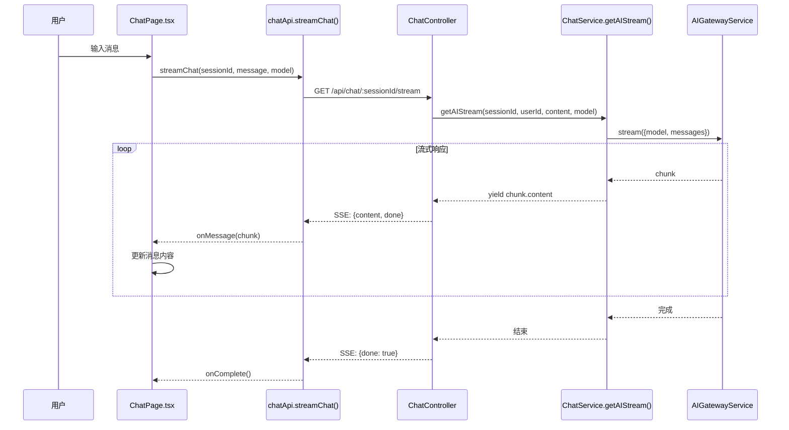
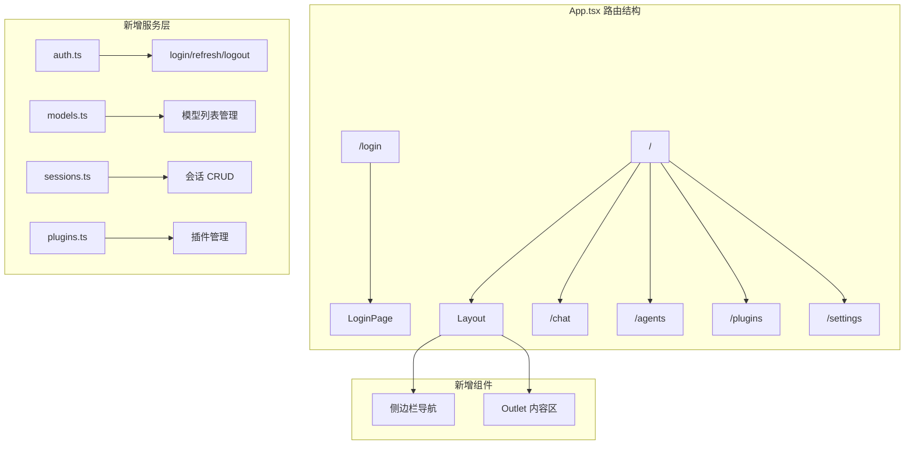
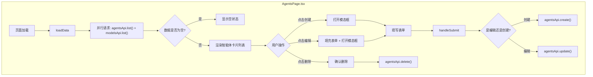

## 1. 高层摘要 (TL;DR)

- **影响级别:** 🟢 **高** - 本次变更涉及前后端核心功能的完整实现，包括流式对话、用户认证、智能体管理等关键业务逻辑。
- **关键变更:**
  1. ✨ **后端流式对话实现** - 将模拟响应替换为真实的 AI 流式输出，支持中断生成
  2. 🔧 **API 路由重构** - 添加全局 `/api` 前缀，SSE 端点从 `@Sse` 改为 `@Get`
  3. 🎨 **前端完整重构** - 新增登录页、布局组件、智能体管理页面，实现完整的 CRUD 功能
  4. 📝 **模型选择器** - 聊天页面新增模型下拉选择功能
  5. 🗄️ **数据库字段调整** - `Message.meta` 字段改为可空，`Session` 创建时自动设置 `lastMessageAt`

---

## 2. 可视化概览 (代码与逻辑映射)

### 2.1 流式对话数据流



### 2.2 前端架构变更



### 2.3 智能体管理页面交互流程



---

## 3. 详细变更分析

### 3.1 后端变更

#### 📦 ChatController (`chat.controller.ts`)

| 变更项 | 旧实现 | 新实现 | 说明 |
|--------|--------|--------|------|
| `sendMessage` 参数 | `SendMessageDto` | `{sessionId, message, model?}` | 移除 DTO 依赖，使用内联类型 |
| `streamChat` 装饰器 | `@Sse` | `@Get` | 改用标准 GET 请求处理 SSE |
| `streamChat` 参数 | `@Body() SendMessageDto` | `@Query('message') @Query('model')` | 改用查询参数 |
| SSE 实现 | 模拟延迟响应 | 调用 `chatService.getAIStream()` | 真实 AI 流式输出 |
| CORS 头 | 无 | `Access-Control-Allow-Origin: *` | 支持跨域 SSE |
| `stopGeneration` | 返回模拟成功 | 调用 `chatService.stopGeneration()` | 实现中断逻辑 |

#### 📦 ChatService (`chat.service.ts`)

**新增方法:**

| 方法名 | 功能 | 关键逻辑 |
|--------|------|----------|
| `getAIStream()` | 返回异步生成器 | 创建 `AbortController`，遍历 `aiGateway.stream()` 的 chunk |
| `stopGeneration()` | 中断流式生成 | 从 `abortControllers` Map 获取并调用 `abort()` |

**关键代码片段:**

```typescript
// 流式生成器实现
return (async function*() {
  try {
    for await (const chunk of self.aiGateway.stream({ model: selectedModel, messages: aiMessages })) {
      if (abortController.signal.aborted) break;
      yield chunk.content;
    }
  } finally {
    self.abortControllers.delete(sessionId);
  }
})();
```

#### 📦 配置与实体变更

| 文件 | 变更内容 |
|------|----------|
| `config.yaml` | `maxTokens`: 262144 → **32768** |
| `message.entity.ts` | `meta: Record<string, any>` → `meta: Record<string, any> \| null` (可空) |
| `main.ts` | 添加 `app.setGlobalPrefix('api')` |
| `sessions.service.ts` | 创建会话时自动设置 `lastMessageAt: new Date()` |

---

### 3.2 前端变更

#### 🎨 新增页面与组件

| 组件/页面 | 路径 | 功能 |
|-----------|------|------|
| **Layout** | `components/layout/index.tsx` | 侧边栏布局，支持折叠，包含导航菜单 |
| **LoginPage** | `pages/Login/index.tsx` | 用户登录表单，调用 `authApi.login()` |
| **AgentsPage** | `pages/Agents/index.tsx` | 完整的智能体 CRUD 界面，含模态框表单 |

#### 📦 服务层新增

| 服务文件 | 提供的 API |
|----------|------------|
| `auth.ts` | `login()`, `refresh()`, `logout()` |
| `models.ts` | `list()`, `get()`, `create()`, `update()`, `delete()`, `enable()`, `disable()` |
| `sessions.ts` | `create()`, `list()`, `get()`, `delete()`, `update()` |
| `plugins.ts` | `list()`, `get()`, `create()`, `update()`, `delete()`, `install()`, `uninstall()`, `enable()`, `disable()` |

#### 📦 ChatPage 重构 (`pages/Chat/index.tsx`)

**新增功能:**
- ✅ 模型选择下拉框 (从 `modelsApi.list()` 获取)
- ✅ SSE 流式消息接收与实时渲染
- ✅ 消息反馈按钮 (👍 👎)
- ✅ 加载状态动画 (三个跳动的点)
- ✅ 中断生成按钮 (🛑)
- ✅ 错误处理 (含 429 限流提示)

**关键状态管理:**

```typescript
const [models, setModels] = useState<AIModelConfig[]>([]);
const [selectedModel, setSelectedModel] = useState<string>('');
const [isLoading, setIsLoading] = useState(false);
const eventSourceRef = useRef<EventSource | null>(null);
```

#### 📦 chatStore 扩展 (`stores/chatStore.ts`)

| 新增状态/方法 | 类型 | 用途 |
|---------------|------|------|
| `streamingContent` | `string` | 存储流式内容 |
| `updateStreamingMessage()` | `(content: string) => void` | 追加流式内容 |
| `setStreamingContent()` | `(content: string) => void` | 设置流式内容 |
| `clearMessages()` | 修改 | 同时清空 `streamingContent` |

#### 📦 chatApi 重写 (`services/chat.ts`)

**核心方法 `streamChat()` 参数表:**

| 参数 | 类型 | 说明 |
|------|------|------|
| `sessionId` | `string` | 会话 ID |
| `message` | `string` | 用户消息 |
| `onMessage` | `(content: string) => void` | 收到 chunk 回调 |
| `model` | `string?` | 可选模型 ID |
| `onComplete` | `() => void?` | 流式完成回调 |
| `onError` | `(error: Event) => void?` | 错误回调 |

---

### 3.3 API 接口变更汇总

| 接口 | 方法 | 变更说明 |
|------|------|----------|
| `/api/chat` | POST | Body 结构变更: `{sessionId, message, model?}` |
| `/api/chat/:sessionId/stream` | GET | 从 SSE 装饰器改为 GET + Query 参数 |
| `/api/chat/:sessionId/stop` | POST | 实现真实中断逻辑 |
| `/api/auth/login` | POST | 新增登录接口 |
| `/api/models` | GET | 新增模型列表接口 |

---

## 4. 影响与风险评估

### ⚠️ 破坏性变更

| 变更项 | 影响范围 | 迁移建议 |
|--------|----------|----------|
| API 全局前缀 `/api` | 所有后端接口 | 前端需更新 baseURL 或代理配置 |
| `streamChat` 端点参数传递方式 | SSE 调用方 | 从 Body 改为 Query 参数 |
| `SendMessageDto` 移除 | 依赖此 DTO 的代码 | 改用内联类型或重新定义 |

### 🧪 测试建议

1. **流式对话测试:**
   - 验证 SSE 连接建立与断开
   - 测试中断生成功能 (`stopGeneration`)
   - 验证错误处理（如 429 限流）

2. **智能体管理测试:**
   - 创建/编辑/删除智能体
   - 验证模型下拉列表加载
   - 测试表单验证

3. **登录流程测试:**
   - 正常登录
   - 错误处理（用户名密码错误）
   - Token 存储与读取

4. **会话管理测试:**
   - 新建会话时 `lastMessageAt` 是否正确设置
   - 会话不存在时自动创建逻辑

### 📝 注意事项

- `Message.meta` 字段已改为可空，需确保数据库迁移正确执行
- 前端 `install.ps1` 脚本会删除 `node_modules` 和 `package-lock.json`，执行前请确认
- SSE 流式响应依赖 `AIGatewayService.stream()` 方法，需确保 AI 适配器正确实现