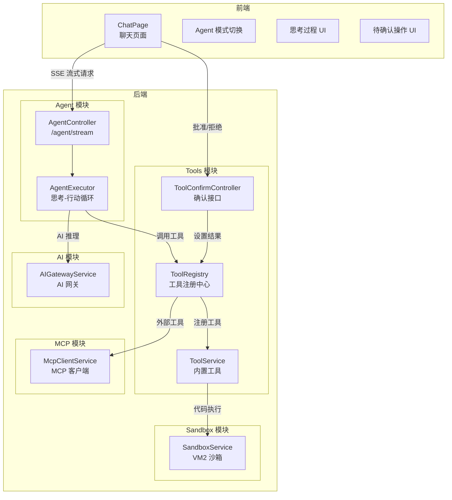
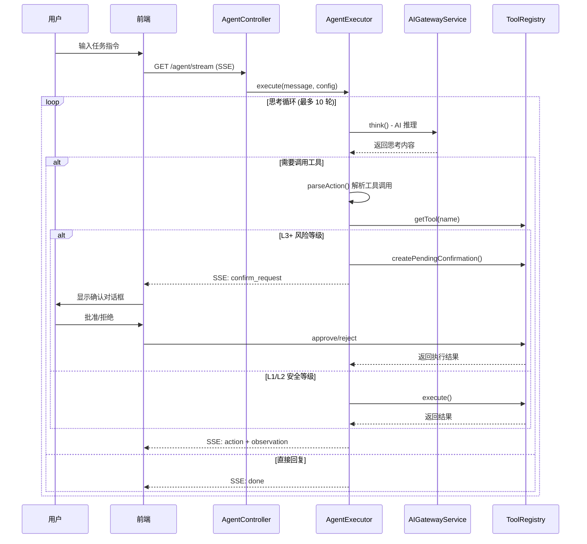
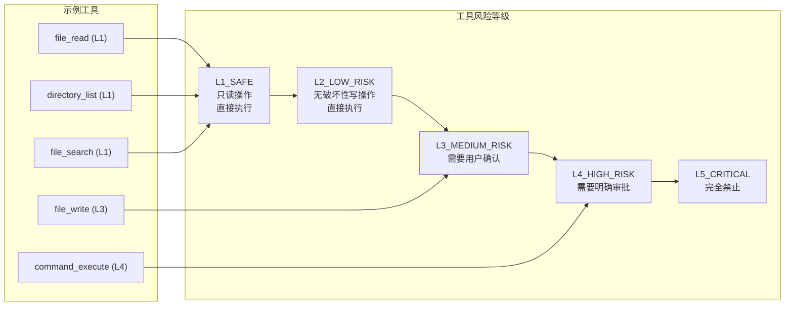

## 1. 高层摘要 (TL;DR)

*   **影响范围:** **高** - 这是一个重大功能更新，为小智 AI 助手平台引入了完整的 **Agent 智能体系统**，包括思考-行动-观察循环、工具注册与执行、风险等级控制、用户确认机制等核心能力。
*   **关键变更:**
    *   ✨ **新增 Agent 模块**：实现基于 ReAct 模式的智能体执行器，支持多轮思考与工具调用
    *   ✨ **新增 Tools 模块**：工具注册中心，支持 L1-L5 五级风险等级，内置文件读写、命令执行等工具
    *   ✨ **新增 MCP 模块**：Model Context Protocol 客户端服务，支持外部工具协议集成
    *   ✨ **新增 Sandbox 模块**：基于 VM2 的代码沙箱执行环境
    *   🎨 **前端 Chat 页面重构**：新增 Agent 模式切换、思考过程可视化、待确认操作 UI

---

## 2. 可视化概览 (代码与逻辑映射)

### 2.1 系统架构图



### 2.2 Agent 执行流程时序图



### 2.3 工具风险等级体系



---

## 3. 详细变更分析

### 3.1 🤖 Agent 模块 (新增)

**文件:** `xiaozhi-backend/src/modules/agent/`

| 文件 | 职责 |
|------|------|
| `agent-executor.service.ts` | 核心执行器，实现 ReAct 模式的思考-行动循环 |
| `agent.controller.ts` | 提供 SSE 流式接口 `/agent/stream` |
| `agent.module.ts` | 模块定义，依赖 ToolsModule 和 AIModule |

**核心逻辑:**
- **System Prompt**: 定义了工具调用格式 `[ACTION] tool_name {...}` 和回复格式 `[REPLY] ...`
- **思考循环**: 最多 10 轮迭代，每轮调用 AI 进行推理
- **超时机制**: AI 请求设置 60 秒超时保护
- **事件流**: 通过 AsyncGenerator 和 SSE 实时推送思考过程

### 3.2 🔧 Tools 模块 (新增)

**文件:** `xiaozhi-backend/src/modules/tools/`

| 文件 | 职责 |
|------|------|
| `tool-registry.service.ts` | 工具注册中心，管理工具生命周期和确认流程 |
| `tool.service.ts` | 内置工具实现（文件读写、目录列表、命令执行） |
| `tool-confirm.controller.ts` | 确认接口 `/tools/pending`, `/tools/approve/:id`, `/tools/reject/:id` |
| `tools.module.ts` | 模块定义 |

**内置工具清单:**

| 工具名称 | 风险等级 | 功能描述 |
|----------|----------|----------|
| `file_read` | L1_SAFE | 读取文件内容 |
| `directory_list` | L1_SAFE | 列出目录内容 |
| `file_search` | L1_SAFE | 搜索文件 |
| `file_write` | L3_MEDIUM_RISK | 写入文件内容（需确认） |
| `command_execute` | L4_HIGH_RISK | 执行 Shell 命令（需确认） |

### 3.3 🔌 MCP 模块 (新增)

**文件:** `xiaozhi-backend/src/modules/mcp/`

| 文件 | 职责 |
|------|------|
| `mcp-client.service.ts` | MCP 协议客户端，支持连接外部工具服务 |
| `mcp.module.ts` | 模块定义 |

**核心功能:**
- 使用 `@modelcontextprotocol/sdk` 实现 MCP 协议
- 支持 Stdio 传输方式连接 MCP 服务器
- 提供 `connect()`, `listTools()`, `callTool()` 等方法

### 3.4 🏖️ Sandbox 模块 (新增)

**文件:** `xiaozhi-backend/src/modules/sandbox/`

| 文件 | 职责 |
|------|------|
| `sandbox.service.ts` | 基于 VM2 的代码沙箱执行环境 |
| `sandbox.module.ts` | 模块定义 |

**安全特性:**
- 可配置超时时间（默认 5 秒）
- 禁用 `eval` 和 `wasm`
- 自定义 console 对象，捕获日志输出

### 3.5 🎨 前端 Chat 页面重构

**文件:** `xiaozhi-frontend/src/pages/Chat/index.tsx`

**新增状态:**
```typescript
const [isAgentMode, setIsAgentMode] = useState(false);
const [thoughtSteps, setThoughtSteps] = useState<ThoughtStep[]>([]);
const [pendingConfirmations, setPendingConfirmations] = useState<...>([]);
const [streamingContent, setStreamingContent] = useState('');
```

**新增功能:**
- **Agent 模式切换**: 按钮切换普通模式与 Agent 模式
- **思考过程可视化**: Claude Code/Trae 风格的折叠式思考块
- **待确认操作 UI**: 底部横幅显示需要用户确认的操作
- **SSE 事件处理**: 解析 `thought`, `action`, `observation`, `confirm_request`, `done`, `error` 事件

### 3.6 📦 依赖更新

**文件:** `xiaozhi-backend/package.json`

| 包名 | 版本 | 用途 |
|------|------|------|
| `@modelcontextprotocol/sdk` | ^1.0.0 | MCP 协议支持 |
| `vm2` | ^3.9.19 | 代码沙箱执行 |

---

## 4. 影响与风险评估

### 4.1 ⚠️ 潜在风险

| 风险项 | 等级 | 说明 |
|--------|------|------|
| **命令执行安全** | 🔴 高 | `command_execute` 工具使用 `spawn` 并设置 `detached: true`，进程脱离父进程独立运行，可能存在安全风险 |
| **VM2 已停止维护** | 🟡 中 | VM2 库已于 2023 年停止维护，存在已知安全漏洞，建议迁移到 `isolated-vm` |
| **SSE 连接管理** | 🟡 中 | 前端 EventSource 在组件卸载时需要正确关闭，避免内存泄漏 |

### 4.2 🧪 测试建议

1. **Agent 执行流程测试**
   - 测试多轮思考循环是否正常终止
   - 测试 AI 超时场景的错误处理
   - 测试工具不存在时的错误提示

2. **工具确认流程测试**
   - 测试 L3+ 工具的确认流程
   - 测试批准/拒绝后 Agent 继续执行
   - 测试多个待确认操作的并发处理

3. **前端 SSE 测试**
   - 测试网络中断后的重连机制
   - 测试快速切换 Agent/普通模式的边界情况
   - 测试思考过程 UI 的展开/收起交互

4. **安全测试**
   - 测试 L5_CRITICAL 工具是否被正确拒绝
   - 测试沙箱代码执行的隔离性
   - 测试命令执行的权限控制

---

## 5. API 接口变更

### 新增接口

| 方法 | 路径 | 说明 |
|------|------|------|
| GET | `/agent/stream` | Agent 流式对话（SSE） |
| GET | `/tools/pending` | 获取待确认操作列表 |
| GET | `/tools/pending/:id` | 获取单个待确认操作详情 |
| POST | `/tools/approve/:id` | 批准操作 |
| POST | `/tools/reject/:id` | 拒绝操作 |

### SSE 事件类型

| 事件类型 | 字段 | 说明 |
|----------|------|------|
| `thought` | `content` | AI 思考内容 |
| `action` | `tool`, `content` | 工具调用开始 |
| `observation` | `content` | 工具执行结果 |
| `confirm_request` | `confirmId`, `tool`, `details` | 需要用户确认 |
| `done` | `content` | 执行完成 |
| `error` | `content` | 发生错误 |