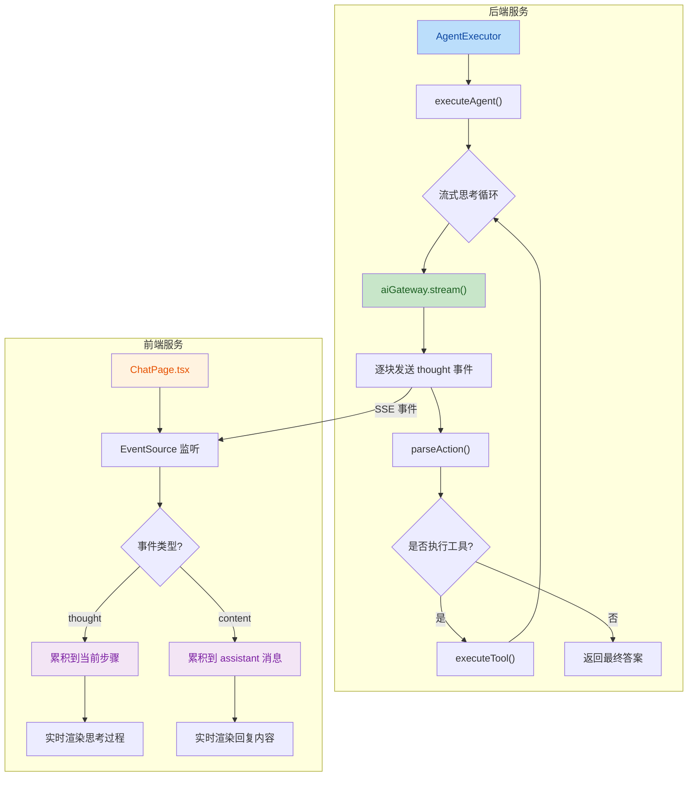
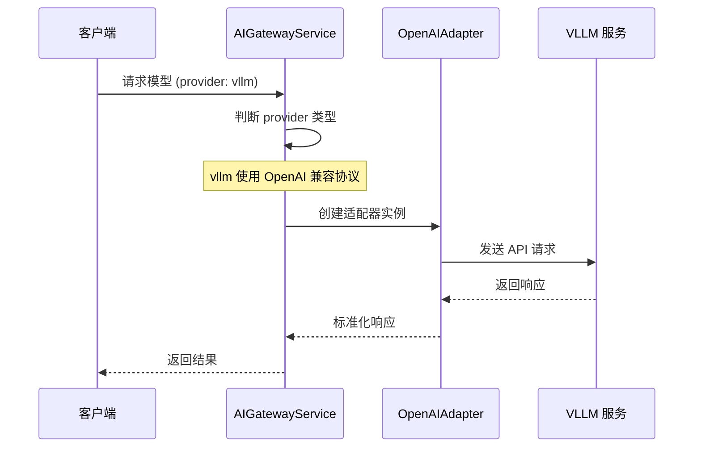

## 1. 高层概览 (TL;DR)

*   **影响程度:** 🟡 **中等** - 核心功能重构，涉及 Agent 思考流程的流式化改造
*   **关键变更:**
    *   ✨ **Agent 思考流式化**: 将 Agent 的思考过程从同步阻塞改为流式输出，提升用户体验
    *   🔧 **VLLM 模型支持**: 新增 `vllm` 作为 AI 模型提供商选项
    *   🎨 **前端流式显示优化**: 重构前端消息处理逻辑，支持实时累积显示
    *   🗑️ **构建产物清理**: 将 `dist/*` 目录加入 `.gitignore`

---

## 2. 可视化概览 (代码与逻辑映射)

### 2.1 Agent 流式思考架构



### 2.2 VLLM 模型适配流程



---

## 3. 详细变更分析

### 3.1 🤖 Agent 执行器服务 (`agent-executor.service.ts`)

**变更类型:** 核心逻辑重构

**变更内容:**
| 变更项 | 旧实现 | 新实现 | 说明 |
|--------|--------|--------|------|
| 思考方式 | 同步 `think()` 方法 | 流式 `aiGateway.stream()` | 提升响应速度 |
| 事件发送 | 思考完成后一次性发送 | 逐块实时发送 | 改善用户体验 |
| 超时处理 | 60秒硬超时 | 依赖流式机制 | 更灵活的错误处理 |

**关键代码片段:**
```typescript
// 新的流式思考逻辑
for await (const chunk of this.aiGateway.stream({
  model: config.model,
  messages: messages.map(m => ({
    role: m.role as 'user' | 'assistant' | 'system',
    content: m.content,
  })),
  temperature: 0.7,
})) {
  thought += chunk.content;
  // 只发送新增的部分
  if (thought.length > lastSentLength) {
    const newContent = thought.substring(lastSentLength);
    context.onEvent({ type: 'thought', content: newContent });
    lastSentLength = thought.length;
  }
}
```

**删除内容:**
- 移除了独立的 `think()` 私有方法（约30行代码）

---

### 3.2 🔌 AI 网关服务 (`ai-gateway.service.ts`)

**变更类型:** 功能扩展

| Provider | 适配器 | 说明 |
|----------|--------|------|
| `openai` | OpenAIAdapter | 原有支持 |
| `anthropic` | ClaudeAdapter | 原有支持 |
| `custom` | 自定义处理 | 原有支持 |
| `vllm` | OpenAIAdapter | 🆕 新增，使用 OpenAI 兼容协议 |

---

### 3.3 📝 配置接口 (`app-config.interface.ts`)

**变更类型:** 类型定义扩展

```typescript
// 扩展了 provider 类型联合
provider: 'openai' | 'anthropic' | 'custom' | 'vllm';  // 新增 'vllm'
```

---

### 3.4 💬 前端聊天页面 (`Chat/index.tsx`)

**变更类型:** 流式处理逻辑重构

#### 3.4.1 思考步骤累积逻辑

| 场景 | 旧行为 | 新行为 |
|------|--------|--------|
| 收到 `thought` 事件 | 创建新的步骤 | 累积到最后一个思考步骤 |
| 多次 thought 事件 | 产生多个步骤卡片 | 单一步骤实时更新 |

#### 3.4.2 Assistant 消息流式更新

```typescript
// 新增：创建空的 assistant 消息用于流式更新
const assistantMsgId = `assistant-${Date.now()}`;
const tempAssistantMsg: Message = {
  id: assistantMsgId,
  sessionId: currentSession?.id || 'default',
  role: 'assistant',
  content: '',
  createdAt: new Date().toISOString(),
};
addMessage(tempAssistantMsg);

// 流式累积内容
accumulatedContent += data.content;
setMessages(prev => {
  const updated = [...prev];
  const lastIdx = updated.findIndex(m => m.id === assistantMsgId);
  if (lastIdx !== -1) {
    updated[lastIdx] = { ...updated[lastIdx], content: accumulatedContent };
  }
  return updated;
});
```

#### 3.4.3 错误处理增强

- 添加了流式请求失败时的消息清理逻辑
- 移除空的 assistant 消息后回退到非流式请求

---

### 3.5 📡 聊天 API 服务 (`chat.ts`)

**变更类型:** 接口简化

| 参数 | 状态 | 说明 |
|------|------|------|
| `onMessage` 回调 | ❌ 移除 | 改为组件内直接处理 |
| `onComplete` 回调 | ❌ 移除 | 改为组件内直接处理 |
| `onError` 回调 | ❌ 移除 | 改为组件内直接处理 |

**影响:** `streamChat()` 方法现在只返回 `EventSource` 实例，事件处理完全由调用方控制。

---

### 3.6 🗂️ 状态管理 (`chatStore.ts`)

**变更类型:** 功能增强

```typescript
// setMessages 现在支持函数式更新
setMessages: (messagesOrUpdater) => set((state) => ({
  messages: typeof messagesOrUpdater === 'function'
    ? messagesOrUpdater(state.messages)
    : messagesOrUpdater
})),
```

**好处:** 支持基于当前状态的增量更新，避免竞态条件。

---

### 3.7 🙈 Git 忽略配置 (`.gitignore`)

| 新增规则 | 说明 |
|----------|------|
| `xiaozhi-backend/dist/*` | 忽略后端编译产物 |
| `xiaozhi-frontend/dist/*` | 忽略前端编译产物 |

---

## 4. 影响与风险评估

### ⚠️ 潜在风险

| 风险项 | 级别 | 说明 | 建议 |
|--------|------|------|------|
| 流式连接中断 | 🟡 中 | 网络不稳定可能导致思考内容丢失 | 已有回退机制，建议添加重连逻辑 |
| 消息状态竞态 | 🟡 中 | 快速发送消息可能导致状态混乱 | 已通过函数式更新缓解，建议添加请求锁 |
| VLLM 兼容性 | 🟢 低 | 依赖 OpenAI 兼容协议 | 建议在配置中明确 baseURL 要求 |

### 🧪 测试建议

1. **流式思考测试:**
   - 验证长思考过程的实时显示效果
   - 测试网络中断后的回退机制
   - 检查多次迭代的思考内容累积

2. **VLLM 集成测试:**
   - 配置 VLLM 模型并验证连接
   - 测试流式输出与非流式输出的一致性

3. **边界场景测试:**
   - 空消息列表时的渲染 (`(messages || []).map()`)
   - 快速连续发送消息的状态管理
   - 错误消息的正确清理

---

## 5. 变更文件统计

| 类别 | 文件数 | 主要变更 |
|------|--------|----------|
| 源代码 | 7 | 核心功能重构 |
| 编译产物 | 100+ | TypeScript 编译输出 |
| 配置文件 | 1 | `.gitignore` 更新 |
| 二进制文件 | 1 | `xiaozhi` 可执行文件 |