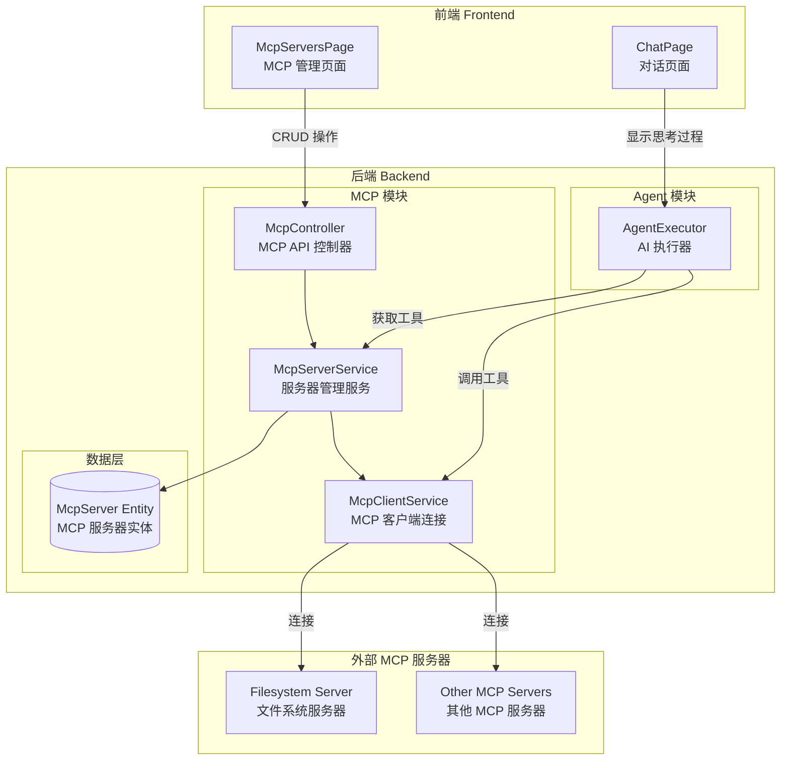
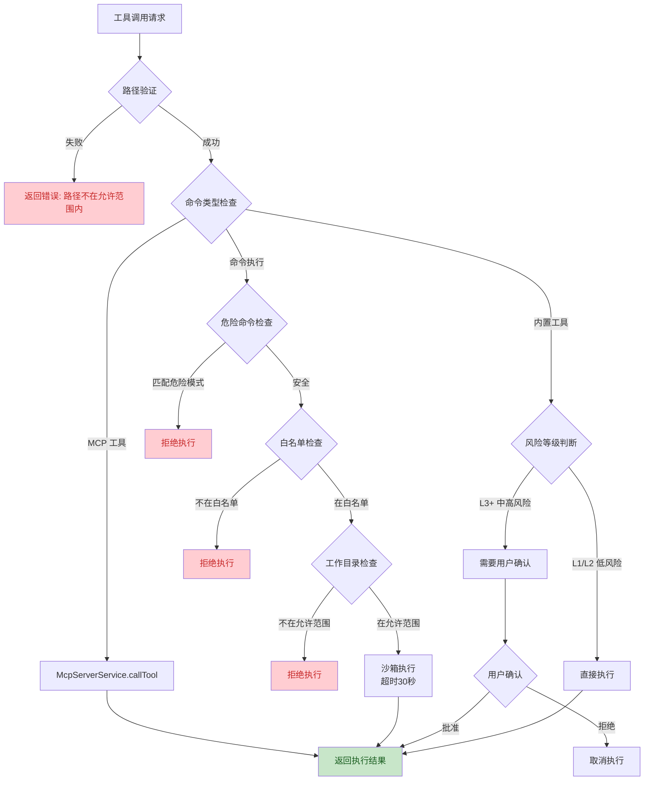
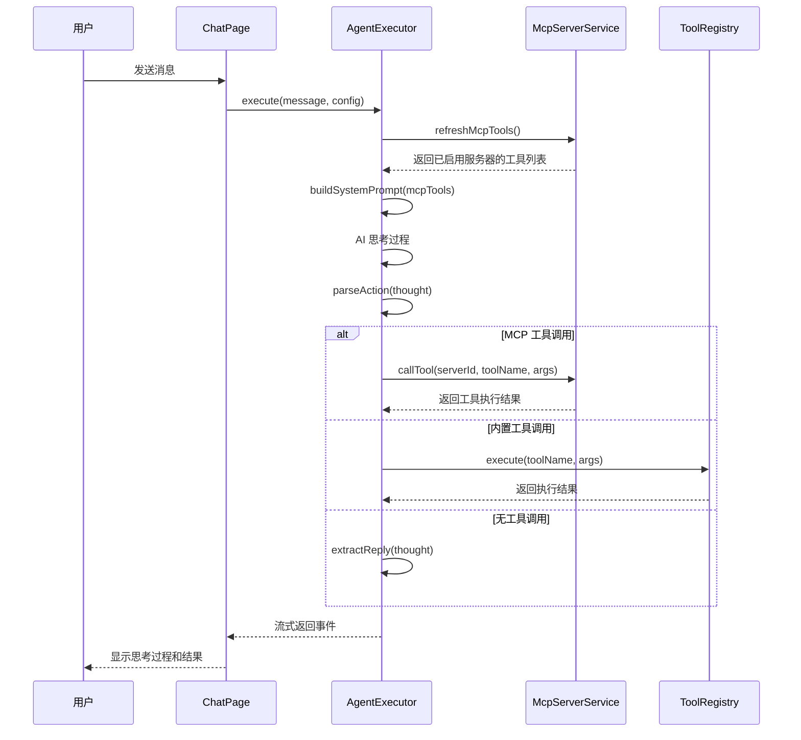

## 1. 高层摘要 (TL;DR)

*   **影响:** **高** - 这是一个重大功能更新，引入了 MCP (Model Context Protocol) 服务器集成能力，并全面增强了系统的安全沙箱机制。
*   **关键变更:**
    *   ✨ **新增 MCP 服务器管理功能**：支持动态添加、启用/禁用、连接/断开 MCP 服务器，AI Agent 可调用外部 MCP 工具。
    *   🔒 **安全沙箱机制**：所有文件操作和命令执行都增加了路径验证、命令白名单、危险命令拦截等安全措施。
    *   🎨 **前端 UI 优化**：新增 MCP 管理页面，改进思考过程显示（支持折叠），增强消息样式。
    *   📊 **Agent 执行器增强**：动态加载 MCP 工具，改进错误处理和日志记录。

---

## 2. 视觉概览 (代码与逻辑地图)

### 2.1 MCP 服务器集成架构



### 2.2 安全沙箱验证流程



### 2.3 Agent 执行流程（含 MCP 工具）



---

## 3. 详细变更分析

### 3.1 🆕 MCP 服务器管理模块

#### **后端实现**

**新增实体：`McpServer`**
- **位置：** `xiaozhi-backend/src/entities/mcp-server.entity.ts`
- **字段：**
  | 字段 | 类型 | 说明 |
  |------|------|------|
  | id | string | 主键 |
  | name | string | 服务器名称 |
  | command | string | 启动命令 |
  | args | string[] | 命令参数 |
  | env | Record<string, string> | 环境变量（可选）|
  | cwd | string | 工作目录（可选）|
  | enabled | boolean | 是否启用 |
  | createdAt | Date | 创建时间 |
  | updatedAt | Date | 更新时间 |

**新增服务：`McpServerService`**
- **位置：** `xiaozhi-backend/src/modules/mcp/mcp-server.service.ts`
- **核心功能：**
  - `onModuleInit()`: 模块初始化时加载配置文件中的默认服务器并连接已启用的服务器
  - `loadDefaultServers()`: 从 `config.yaml` 加载默认 MCP 服务器配置
  - `connectServer()`: 连接 MCP 服务器（带10秒超时控制）
  - `getTools()`: 获取已启用服务器的所有工具列表
  - `callTool()`: 调用 MCP 工具

**新增控制器：`McpController`**
- **位置：** `xiaozhi-backend/src/modules/mcp/mcp.controller.ts`
- **API 端点：**
  | 方法 | 路径 | 功能 |
  |------|------|------|
  | GET | `/mcp/servers` | 获取所有服务器 |
  | GET | `/mcp/servers/:id` | 获取单个服务器 |
  | POST | `/mcp/servers` | 创建服务器 |
  | PUT | `/mcp/servers/:id` | 更新服务器 |
  | DELETE | `/mcp/servers/:id` | 删除服务器 |
  | POST | `/mcp/servers/:id/connect` | 连接服务器 |
  | POST | `/mcp/servers/:id/disconnect` | 断开服务器 |
  | GET | `/mcp/servers/:id/tools` | 获取服务器工具 |
  | GET | `/mcp/tools` | 获取所有已启用服务器的工具 |

**配置文件更新：`config.yaml`**
- 新增 MCP 服务器配置节点：
```yaml
mcp:
  servers:
    - id: filesystem
      name: Filesystem
      command: npx
      args: ["-y", "@modelcontextprotocol/server-filesystem", "D:\\project"]
      enabled: false
```

#### **前端实现**

**新增页面：`McpServersPage`**
- **位置：** `xiaozhi-frontend/src/pages/McpServers/index.tsx`
- **功能：**
  - 展示 MCP 服务器列表（支持展开/折叠）
  - 添加/编辑/删除服务器
  - 启用/禁用服务器
  - 连接/断开服务器
  - 实时状态显示

**新增服务：`mcp.ts`**
- **位置：** `xiaozhi-frontend/src/services/mcp.ts`
- **封装 API 调用：**
  - `getMcpServers()`, `createMcpServer()`, `updateMcpServer()`, `deleteMcpServer()`
  - `connectMcpServer()`, `disconnectMcpServer()`
  - `getMcpTools()`

**路由更新：**
- `App.tsx`: 新增路由 `/mcp-servers`
- `layout/index.tsx`: 导航栏新增 "MCP" 菜单项

---

### 3.2 🔒 安全沙箱机制增强

#### **路径验证机制**
- **位置：** `xiaozhi-backend/src/modules/tools/tool.service.ts`
- **允许的根目录（SANDBOX_ROOTS）：**
  1. `~/.xiaozhi/sandbox` - 用户沙箱目录
  2. `D:\project\XiaoZhi` - 项目根目录
  3. `process.cwd()` - 当前工作目录

- **验证逻辑：**
```typescript
private validateSandboxPath(targetPath: string): { valid: boolean; error?: string } {
  // 检查路径是否在允许的根目录下
  // 返回 { valid: true } 或 { valid: false, error: '路径不在允许范围内' }
}
```

#### **命令执行安全增强**

**危险命令拦截：**
```typescript
const dangerousPatterns = [
  /rm\s+-rf\s+\//i,           // 删除系统
  /mkfs\./i,                   // 格式化
  /dd\s+if=/i,                 // 直接磁盘写入
  /:(){ :|:& };:/i,           // Fork炸弹
  /\.\.\/.*\.conf/i,          // 路径穿越
];
```

**命令白名单：**
```typescript
const allowedCommands = [
  'dir', 'ls', 'pwd', 'cd', 'echo', 'type', 'cat',
  'find', 'grep', 'head', 'tail', 'wc', 'sort', 'uniq',
  'node', 'npm', 'pnpm', 'git', 'curl', 'ping',
  'tasklist', 'taskkill', 'ps', 'kill', 'netstat',
  'Get-Process', 'Get-ChildItem', 'Select-Object', 'Where-Object',
];
```

**执行控制：**
- 默认工作目录：`~/.xiaozhi/sandbox`
- 超时控制：30秒
- 输出捕获：stdout 和 stderr
- 进程隔离：使用 `spawn` 而非 `exec`

#### **工具执行改进**

**优先使用沙箱命令：**
- 文件读取：优先使用 `type` (Windows) 或 `cat` (Linux)
- 目录列表：优先使用 `Get-ChildItem` (PowerShell) 或 `ls -la` (Bash)
- 文件搜索：优先使用 `Get-ChildItem -Recurse` 或 `find`
- 文件写入：优先使用 `Set-Content` 或 `echo >`

**降级策略：**
- 如果沙箱命令失败，降级到原生 Node.js `fs` 模块
- 返回详细的执行信息（终端类型、命令、工作目录）

---

### 3.3 🤖 Agent 执行器增强

#### **MCP 工具集成**
- **位置：** `xiaozhi-backend/src/modules/agent/agent-executor.service.ts`
- **关键变更：**
  1. 实现 `OnModuleInit` 接口，初始化时加载 MCP 工具
  2. 新增 `refreshMcpTools()` 方法，每次执行前刷新工具列表
  3. 新增 `buildSystemPrompt()` 函数，动态生成包含 MCP 工具的系统提示

**系统提示示例：**
```
内置工具：
1. file_read(path): 读取文件
2. directory_list(path): 列出目录
...

MCP 服务器工具（来自外部 MCP 服务器）：
- search_web(query): 搜索网络
- read_pdf(path): 读取 PDF 文件
```

#### **工具执行流程改进**

**优先级判断：**
```typescript
// 1. 检查是否是 MCP 工具
const mcpTool = this.mcpTools.find(t => t.name === action.name);
if (mcpTool) {
  // 直接执行 MCP 工具
}

// 2. 检查是否是内置工具
const tool = this.toolRegistry.getTool(action.name);
if (!tool) {
  // 工具不存在
}

// 3. 检查风险等级
if (tool.level === ToolLevel.L5_CRITICAL) {
  // 拒绝执行
}

// 4. 中高风险需要确认
if (tool.level >= ToolLevel.L3_MEDIUM_RISK) {
  // 请求用户确认
}

// 5. 低风险直接执行
```

#### **日志和错误处理增强**
- 增加了详细的日志记录（chunk 数量、思考内容长度）
- 改进了空内容处理逻辑（使用最后的 observation）
- 增强了 `extractReply()` 函数，支持多行回复内容
- 循环结束后确保发送 `done` 事件

---

### 3.4 🎨 前端 UI 改进

#### **思考过程显示优化**
- **位置：** `xiaozhi-frontend/src/pages/Chat/index.tsx`
- **关键变更：**
  1. **思考过程持久化**：将思考步骤保存到消息对象的 `thinkingSteps` 字段
  2. **折叠功能**：新增 `collapsedThinking` 状态，支持展开/折叠历史消息的思考过程
  3. **仅在加载时显示**：思考过程只在 AI 思考过程中显示，完成后折叠到消息下方
  4. **改进样式**：区分不同类型的步骤（thinking/action/observation）

**消息类型增强：**
```typescript
export interface Message {
  // ... 其他字段
  thinkingSteps?: Array<{
    type: 'thinking' | 'action' | 'observation';
    label: string;
    content: string;
  }>;
}
```

#### **消息显示样式增强**
- 空内容警告提示
- 警告消息样式（黄色边框）
- 系统消息样式（灰色背景）
- 改进的消息气泡样式

#### **其他 UI 改进**
- 默认启用 Agent 模式（`isAgentMode` 初始值改为 `true`）
- 新增警告色主题配置（`tailwind.config.js`）
- 改进工具执行详情显示（终端类型、命令、工作目录）

---

## 4. 影响与风险评估

### 4.1 ⚠️ 破坏性变更

| 变更类型 | 影响范围 | 说明 |
|---------|---------|------|
| 数据库 Schema | 新增表 `mcp_servers` | 需要确保数据库同步（`synchronize: true` 已启用）|
| API 端点 | 新增多个端点 | 无破坏性，纯新增 |
| 工具执行逻辑 | 所有工具调用 | 增加了路径验证，可能影响现有工具调用 |
| 系统提示格式 | Agent 执行 | 格式变更可能影响 AI 理解，需测试 |

### 4.2 🧪 测试建议

#### **功能测试**
1. **MCP 服务器管理**
   - 测试添加/编辑/删除服务器
   - 测试启用/禁用服务器
   - 测试连接/断开服务器
   - 测试获取工具列表

2. **安全沙箱**
   - 测试路径验证（允许的路径和禁止的路径）
   - 测试危险命令拦截
   - 测试命令白名单
   - 测试工作目录限制
   - 测试超时控制

3. **Agent 执行**
   - 测试 MCP 工具调用
   - 测试内置工具调用
   - 测试混合工具调用
   - 测试错误处理和重试

#### **边界测试**
- 空内容处理
- 超长思考过程
- 并发工具调用
- 网络断开时的 MCP 服务器连接

#### **安全测试**
- 尝试访问禁止路径
- 尝试执行危险命令
- 尝试路径穿越攻击
- 测试命令注入防护

### 4.3 📝 部署注意事项

1. **数据库迁移**
   - 确保 `synchronize: true` 已启用，自动创建 `mcp_servers` 表
   - 或手动执行 SQL 创建表结构

2. **配置文件**
   - 更新 `config.yaml`，添加 MCP 服务器配置节点
   - 根据实际环境调整路径和参数

3. **依赖安装**
   - 确保 MCP 服务器依赖已安装（如 `@modelcontextprotocol/server-filesystem`）

4. **环境变量**
   - 检查是否需要设置新的环境变量（如 MCP 服务器路径）

---

## 5. 代码质量观察

### 5.1 ✅ 优点
- **安全性强**：多层次的安全检查机制
- **架构清晰**：MCP 模块独立，职责分明
- **用户体验好**：思考过程可视化，操作直观
- **可扩展性强**：支持动态添加 MCP 服务器

### 5.2 ⚠️ 潜在问题
- **硬编码路径**：`D:\project\XiaoZhi` 硬编码在代码中，建议改为配置项
- **超时时间固定**：连接超时 10 秒、命令执行超时 30 秒，建议可配置
- **错误处理**：部分错误只记录日志，未向用户返回详细错误信息
- **性能考虑**：每次执行前都刷新 MCP 工具列表，可能影响性能

### 5.3 🔧 改进建议
1. 将硬编码路径移到配置文件
2. 增加超时时间的配置项
3. 改进错误信息的国际化
4. 考虑缓存 MCP 工具列表，定期刷新而非每次执行都刷新
5. 增加单元测试和集成测试

---

**总结：** 这是一个高质量的功能更新，引入了强大的 MCP 服务器集成能力，同时显著提升了系统的安全性。代码结构清晰，功能完整，建议在充分测试后部署到生产环境。