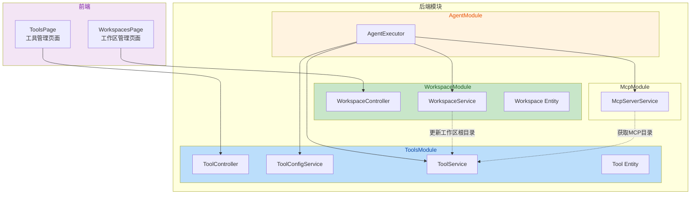
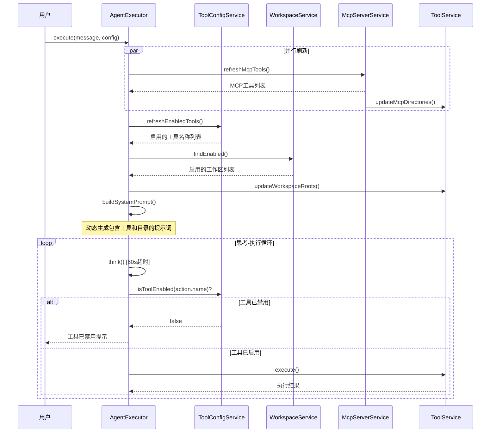
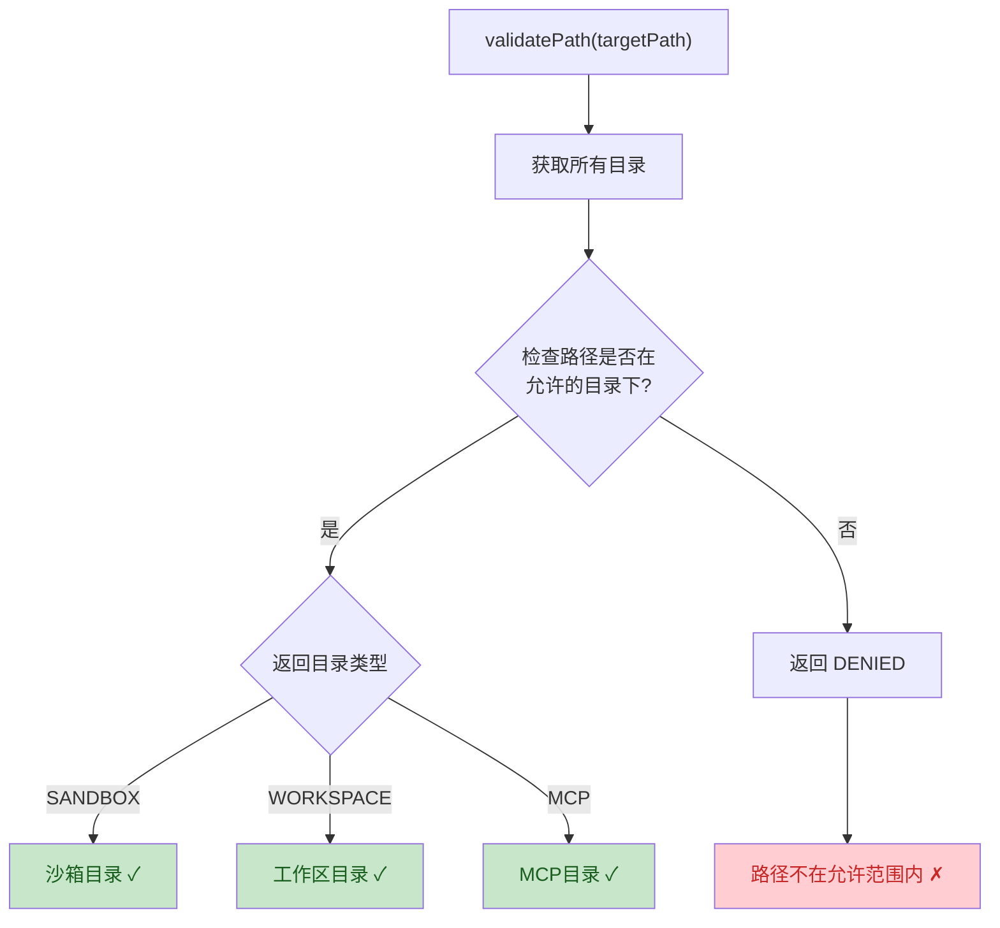

## 1. 高层摘要 (TL;DR)

*   **影响范围:** **高** - 本次变更重构了工作区模块，新增了完整的工具管理系统，并改进了 Agent 执行器的权限控制机制。
*   **关键变更:**
    *   🔄 **工作区模块重构**: 从用户关联的多工作区模式改为简化的全局工作区管理，支持启用/禁用状态。
    *   ✨ **新增工具管理系统**: 创建 `Tool` 实体和完整的 CRUD 接口，支持内置工具的启用/禁用控制。
    *   🔐 **动态目录权限**: Agent 执行时动态获取工作区和 MCP 服务器目录，实现灵活的文件访问控制。
    *   🛠️ **文件编码优化**: 改进 Windows 环境下的文件读取，自动检测 UTF-8/GBK 编码。
    *   ⏱️ **AI 流式超时**: 为 AI 响应添加 60 秒超时控制，防止无限等待。

---

## 2. 可视化概览 (代码与逻辑映射)

### 2.1 系统架构变更



### 2.2 Agent 执行流程



### 2.3 目录权限验证流程



---

## 3. 详细变更分析

### 3.1 🔄 工作区模块重构

**变更说明**: 将原有的用户关联工作区模块 (`workspaces`) 重构为全局工作区管理模块 (`workspace`)。

| 变更项 | 旧实现 | 新实现 | 说明 |
|--------|--------|--------|------|
| 模块名称 | `WorkspacesModule` | `WorkspaceModule` | 单数形式 |
| 用户关联 | `userId` + `user` 关系 | 无 | 移除用户绑定 |
| 字段 | `rootPath`, `description`, `deletedAt` | `path`, `enabled` | 简化字段 |
| API 路径 | `/workspaces` | `/workspaces` | 保持一致 |

**Workspace Entity 变更**:
```typescript
// 旧实体字段
userId: string;
rootPath: string;
description: string;
deletedAt: Date;
user: User;

// 新实体字段
name: string;
path: string;
enabled: boolean;  // 新增：启用状态
createdAt: Date;
updatedAt: Date;
```

---

### 3.2 ✨ 新增工具管理系统

**新增文件**:
- `xiaozhi-backend/src/entities/tool.entity.ts`
- `xiaozhi-backend/src/modules/tools/tool-config.service.ts`
- `xiaozhi-backend/src/modules/tools/tool.controller.ts`

**Tool Entity 结构**:

| 字段 | 类型 | 说明 |
|------|------|------|
| `id` | UUID | 主键 |
| `name` | string | 工具名称（唯一） |
| `description` | string | 工具描述 |
| `enabled` | boolean | 启用状态（默认 true） |
| `level` | number | 风险等级 1-5 |

**内置工具初始化**:

| 工具名称 | 描述 | 风险等级 |
|----------|------|----------|
| `file_read` | 读取文件内容 | L1 安全 |
| `directory_list` | 列出目录内容 | L1 安全 |
| `file_search` | 搜索文件 | L1 安全 |
| `file_write` | 写入文件 | L2 低风险 |
| `command_execute` | 执行命令 | L3 中风险 |

**新增 API 端点**:

| 方法 | 路径 | 说明 |
|------|------|------|
| GET | `/tools` | 获取所有工具列表 |
| GET | `/tools/enabled` | 获取已启用工具 |
| POST | `/tools/:id/enable` | 启用工具 |
| POST | `/tools/:id/disable` | 禁用工具 |
| POST | `/tools/init` | 初始化内置工具 |

---

### 3.3 🔐 动态目录权限系统

**目录类型枚举**:

| 类型 | 说明 | 来源 |
|------|------|------|
| `SANDBOX` | 沙箱目录 | `~/.xiaozhi/sandbox` |
| `WORKSPACE` | 工作区目录 | 数据库配置 |
| `MCP` | MCP 服务器目录 | MCP 配置的 args/cwd |
| `DENIED` | 拒绝访问 | 路径验证失败 |

**ToolService 新增方法**:

| 方法 | 说明 |
|------|------|
| `updateWorkspaceRoots()` | 更新工作区目录列表 |
| `updateMcpDirectories()` | 更新 MCP 服务器目录 |
| `getAllDirectories()` | 获取所有允许的目录 |
| `validatePath()` | 验证路径权限（返回目录类型） |
| `searchFiles()` | 递归搜索文件 |

---

### 3.4 🛠️ 文件编码优化

**新增编码检测函数** `detectAndReadFile()`:

```typescript
// 检测流程:
1. 尝试 UTF-8 读取，检查是否有替换字符 (U+FFFD)
2. 尝试 GBK 编码（使用 PowerShell 转换）
3. 回退到 binary 模式读取
```

**PowerShell 命令优化**:
- 文件读取: `Get-Content -Path '...' -Raw -Encoding UTF8`
- 目录列表: `Get-ChildItem | Format-Table Name, Mode -AutoSize`
- 强制 UTF-8 输出: `[Console]::OutputEncoding = [System.Text.Encoding]::UTF8`

---

### 3.5 ⏱️ Agent 执行器改进

**新增功能**:

| 功能 | 说明 |
|------|------|
| 工具启用检查 | 执行前检查 `isToolEnabled()` |
| 工作区目录刷新 | `refreshWorkspaceRoots()` |
| MCP 目录刷新 | 从 MCP 服务获取目录 |
| AI 流式超时 | 60 秒超时控制 |

**System Prompt 动态生成**:
```typescript
buildSystemPrompt(mcpTools, directories, enabledBuiltinTools)
// 输出包含:
// - 已启用的内置工具列表
// - 允许访问的目录（沙箱/工作区/MCP）
// - MCP 服务器工具
```

---

### 3.6 🖥️ 前端变更

**新增页面**:
- `WorkspacesPage` - 工作区管理（增删改查、启用/禁用）
- `ToolsPage` - 工具管理（列表展示、启用/禁用）

**导航栏新增**:
| 路径 | 图标 | 标签 |
|------|------|------|
| `/workspaces` | Folder | 工作区 |
| `/tools` | Wrench | 工具 |

---

## 4. 影响与风险评估

### 4.1 ⚠️ 破坏性变更

| 变更 | 影响 | 迁移建议 |
|------|------|----------|
| `WorkspacesModule` → `WorkspaceModule` | 导入路径变更 | 更新所有引用 |
| Workspace Entity 字段变更 | 数据库结构变化 | 需要数据迁移 |
| 移除 `userId` 关联 | 用户工作区数据丢失 | 备份并迁移数据 |

### 4.2 🧪 测试建议

1. **工作区管理**:
   - 测试工作区的创建、编辑、删除功能
   - 验证启用/禁用状态切换
   - 确认路径验证正确性

2. **工具管理**:
   - 测试内置工具初始化
   - 验证工具启用/禁用状态持久化
   - 确认禁用工具无法被 Agent 调用

3. **Agent 执行**:
   - 测试 AI 流式响应超时场景
   - 验证动态目录权限生效
   - 测试文件编码自动检测（中文文件）

4. **文件操作**:
   - 测试 UTF-8 和 GBK 编码文件读取
   - 验证 PowerShell 命令执行稳定性
   - 测试递归文件搜索功能

---

## 5. 文件变更清单

| 文件路径 | 变更类型 |
|----------|----------|
| `xiaozhi-backend/src/app.module.ts` | 修改 |
| `xiaozhi-backend/src/entities/user.entity.ts` | 修改 |
| `xiaozhi-backend/src/entities/workspace.entity.ts` | 重构 |
| `xiaozhi-backend/src/entities/tool.entity.ts` | **新增** |
| `xiaozhi-backend/src/modules/agent/agent-executor.service.ts` | 修改 |
| `xiaozhi-backend/src/modules/agent/agent.module.ts` | 修改 |
| `xiaozhi-backend/src/modules/mcp/mcp-server.service.ts` | 修改 |
| `xiaozhi-backend/src/modules/tools/tool.service.ts` | 修改 |
| `xiaozhi-backend/src/modules/tools/tools.module.ts` | 修改 |
| `xiaozhi-backend/src/modules/tools/tool-config.service.ts` | **新增** |
| `xiaozhi-backend/src/modules/tools/tool.controller.ts` | **新增** |
| `xiaozhi-backend/src/modules/workspace/*` | **新增** |
| `xiaozhi-backend/src/modules/workspaces/*` | **删除** |
| `xiaozhi-frontend/src/App.tsx` | 修改 |
| `xiaozhi-frontend/src/components/layout/index.tsx` | 修改 |
| `xiaozhi-frontend/src/services/tools.ts` | 重构 |
| `xiaozhi-frontend/src/services/workspaces.ts` | **新增** |
| `xiaozhi-frontend/src/pages/Tools/index.tsx` | **新增** |
| `xiaozhi-frontend/src/pages/Workspaces/index.tsx` | **新增** |