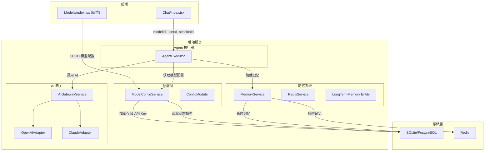
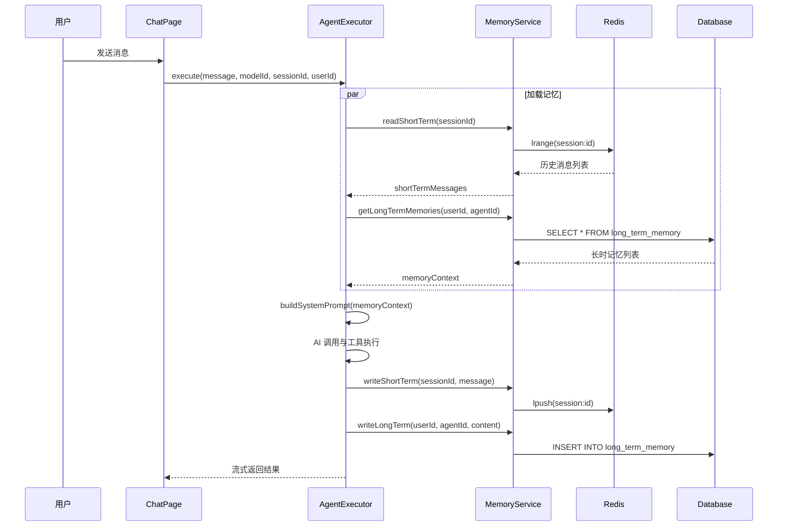

## 1. 高层摘要 (TL;DR)

*   **影响范围:** **高** - 重构了模型配置系统，实现了完整的记忆系统，新增前端模型管理页面
*   **关键变更:**
    1.  🧠 **记忆系统实现**: 实现了短时记忆(Redis)和长时记忆(数据库)的完整功能
    2.  🔐 **API密钥加密**: 新增 AES-256 加密存储，支持动态添加模型
    3.  📦 **模型配置分离**: 将模型 ID 与 API 模型名分离，支持预制模型与动态模型
    4.  🖥️ **前端模型管理页**: 新增模型管理界面，支持添加/编辑/删除模型
    5.  ⏱️ **深度思考模型支持**: 增加超时时间，优化思考内容渲染

---

## 2. 可视化概览 (代码与逻辑映射)

### 2.1 系统架构变更



### 2.2 记忆系统数据流



---

## 3. 详细变更分析

### 3.1 🧠 记忆系统

| 组件 | 变更说明 |
|------|----------|
| **MemoryService** | 从 TODO 状态完整实现，支持短时/长时记忆的读写、搜索、清除 |
| **RedisService** | 从 Mock 实现为完整的 Redis 客户端，支持内存备用存储 |
| **LongTermMemory Entity** | 新增数据库实体，存储用户对话记忆 |

#### 记忆系统 API 变更表

| 端点 | 方法 | 变更 |
|------|------|------|
| `/memory/config` | GET | 新增 - 获取记忆配置 |
| `/memory/short-term/:sessionId` | GET | 增加 `limit` 参数 |
| `/memory/short-term/:sessionId` | DELETE | 新增 - 清除短时记忆 |
| `/memory/long-term` | GET | 新增 - 获取长时记忆列表 |
| `/memory/long-term/:memoryId` | DELETE | 新增 - 删除长时记忆 |
| `/memory/stats` | GET | 新增 - 获取记忆统计 |

### 3.2 🔐 模型配置系统

| 文件 | 变更说明 |
|------|----------|
| **AIModelConfig** | 新增 `model` 字段（API 模型名），`baseURL` 改为可选 |
| **ModelConfigService** | 重构为异步初始化，支持数据库持久化，预制模型保护 |
| **Model Entity** | 新增实体，存储动态添加的模型配置 |
| **encryption.ts** | 新增 AES-256-CBC 加密工具类 |

#### 模型配置字段变更表

| 字段 | 旧值 | 新值 | 说明 |
|------|------|------|------|
| `model` | 无 | `string` | API 模型名，与 ID 分离 |
| `baseURL` | `string` | `string?` | 改为可选 |
| `encryptedApiKey` | 无 | `string?` | 加密存储的 API Key |

#### 预制模型 vs 动态模型

| 特性 | 预制模型 | 动态模型 |
|------|----------|----------|
| 来源 | `config.yaml` | 数据库 |
| 可删除 | ❌ 不可删除 | ✅ 可删除 |
| 可编辑 | ❌ 仅可启用/禁用 | ✅ 完全可编辑 |
| API Key | 环境变量 | 加密存储 |

### 3.3 🤖 Agent 执行器

| 变更点 | 说明 |
|--------|------|
| **参数变更** | `model` → `modelId`，新增 `userId`、`agentId`、`sessionId`、`enableMemory` |
| **记忆集成** | 执行前加载短时/长时记忆，执行后保存对话到记忆 |
| **超时优化** | 60s → 180s（支持深度思考模型如 Deepseek） |
| **回复提取** | 支持 `<thinking>` 标签解析，优化 `[REPLY]` 提取逻辑 |

### 3.4 🖥️ 前端变更

| 文件 | 变更说明 |
|------|----------|
| **Models/index.tsx** | 新增模型管理页面，支持 CRUD 操作 |
| **Chat/index.tsx** | 增加 `renderThoughtContent()` 渲染思考内容，请求参数增加记忆相关字段 |
| **App.tsx** | 新增 `/models` 路由 |
| **layout/index.tsx** | 导航栏新增"模型"入口 |

---

## 4. 影响与风险评估

### ⚠️ 破坏性变更

| 变更 | 影响 | 迁移建议 |
|------|------|----------|
| Agent API 参数变更 | `model` → `modelId` | 前端已同步更新，需检查其他调用方 |
| 新增数据库实体 | 需要数据库同步 | 确保 `synchronize: true` 或手动迁移 |

### 🔒 安全风险

| 风险点 | 说明 | 建议 |
|--------|------|------|
| 默认加密密钥 | `ENCRYPTION_KEY` 使用默认值 | ⚠️ 生产环境必须设置环境变量 |
| API Key 明文传输 | 前端到后端传输 API Key | 建议使用 HTTPS |

### 🧪 测试建议

1.  **记忆系统测试**
    - 测试 Redis 不可用时的内存备用存储
    - 验证长时记忆的关键词搜索功能
    - 测试记忆整合功能

2.  **模型管理测试**
    - 测试添加/编辑/删除动态模型
    - 验证预制模型的保护机制
    - 测试 API Key 加密/解密

3.  **深度思考模型测试**
    - 测试 Deepseek-reasoner 的超时处理
    - 验证 `<thinking>` 标签的正确渲染

---

## 5. 配置变更摘要

### config.yaml 新增配置

```yaml
# 模型配置新增 model 字段
models:
  enabled:
    - id: gpt-4o-mini
      model: gpt-4o-mini    # 新增：API 模型名

# 向量配置改为 embedding
embedding:
  provider: none  # none | api | pgvector
  dimension: 1536

# 新增加密密钥
ENCRYPTION_KEY: xiaozhi-encryption-key-change-in-production
```

### 新增依赖

| 包名 | 用途 |
|------|------|
| `ioredis` | Redis 客户端 |
| `crypto` | Node.js 内置加密模块 |