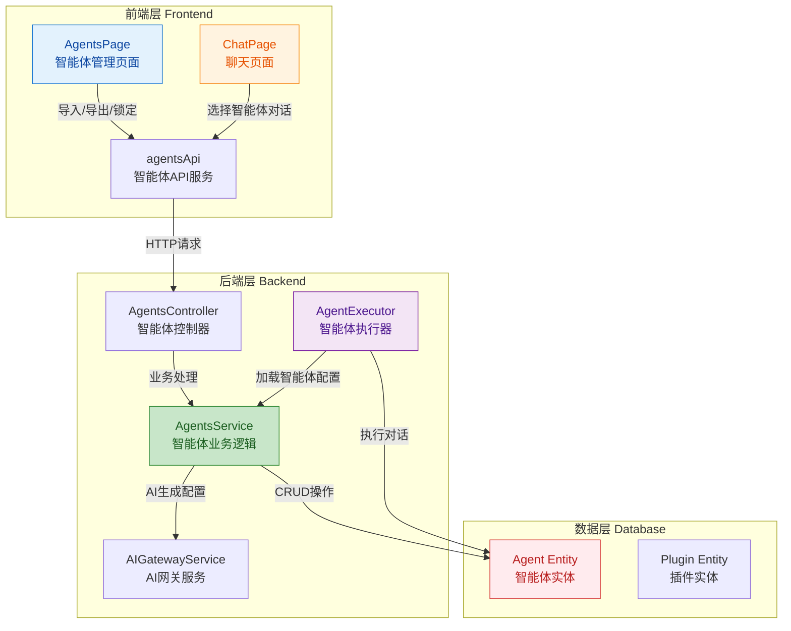
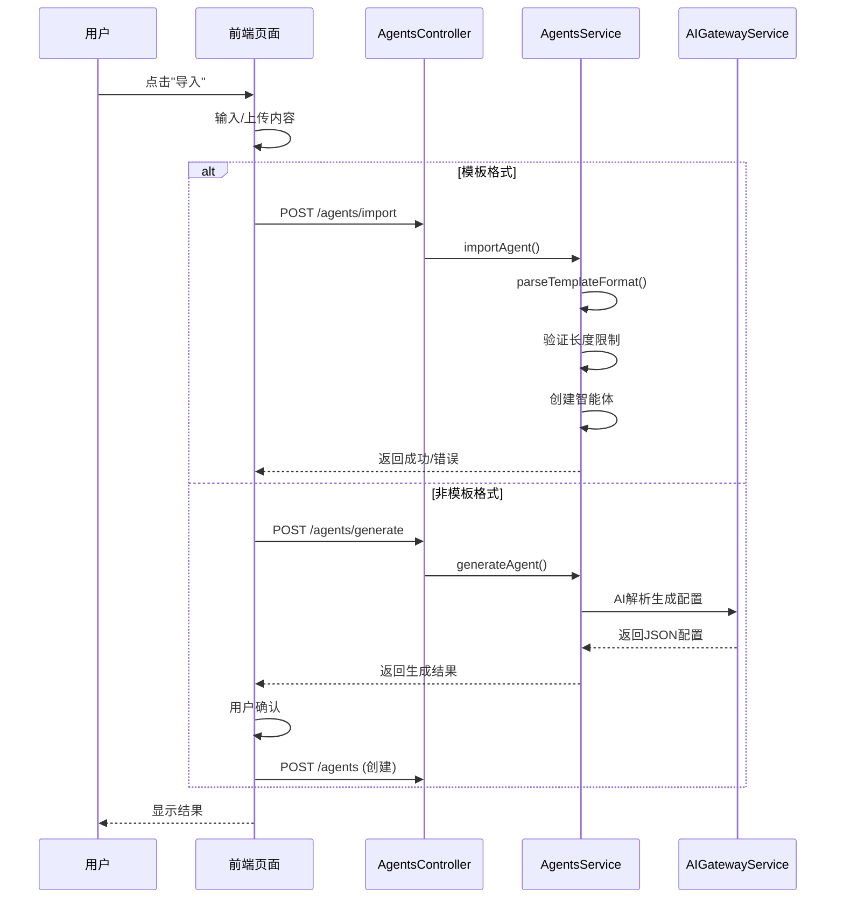
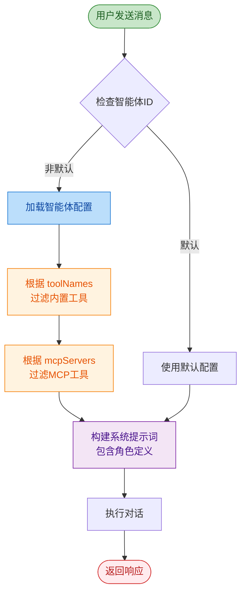

## 1. 高层概览 (TL;DR)

**影响范围：** 🟢 **中等** - 本次更新大幅增强了智能体管理系统的功能，引入了锁定机制、导入导出能力、AI辅助生成以及工具/MCP服务器配置能力，同时优化了前端请求管理机制。

**核心变更：**
- ✨ **智能体实体增强**：新增 `slug`（英文标识名）、`locked`（锁定状态）、`toolNames`（工具列表）、`mcpServers`（MCP服务器列表）字段
- 🔒 **锁定机制**：防止重要智能体被误修改或删除
- 📤 **导入导出功能**：支持 Markdown 模板格式导入导出，支持 AI 智能解析生成配置
- 🛠️ **工具配置**：智能体可关联特定工具和 MCP 服务器
- 🎯 **聊天集成**：聊天页面可选择不同智能体进行对话
- 🐛 **前端优化**：使用 `AbortController` 解决 React StrictMode 双重请求问题

---

## 2. 可视化概览（代码与逻辑映射）

### 2.1 智能体系统架构图



### 2.2 智能体导入导出流程



### 2.3 智能体执行流程（含工具过滤）



---

## 3. 详细变更分析

### 3.1 📦 后端实体与数据库变更

#### **Agent 实体新增字段**

| 字段名 | 类型 | 说明 | 约束 |
|--------|------|------|------|
| `slug` | `string` | 英文标识名，用于URL标识 | `unique: true, nullable: true, length: 100` |
| `locked` | `boolean` | 锁定状态，防止误修改 | `default: false` |
| `mcpServers` | `string[]` | 关联的MCP服务器列表 | `type: json, nullable: true` |
| `toolNames` | `string[]` | 关联的工具名称列表 | `type: json, nullable: true` |

**来源：** `xiaozhi-backend/src/entities/agent.entity.ts`

---

### 3.2 🔧 后端服务层变更

#### **AgentsService 新增功能**

| 方法 | 功能 | 关键逻辑 |
|------|------|----------|
| `toggleLock()` | 锁定/解锁智能体 | 设置 `locked` 状态 |
| `exportAgent()` | 导出智能体为Markdown | 生成标准模板格式 |
| `importAgent()` | 导入智能体（支持模板和智能解析） | 解析模板格式，验证长度限制 |
| `generateAgent()` | AI生成智能体配置 | 调用 `AIGatewayService` 生成 name/slug/description/prompt |
| `findById()` | 通过ID查找智能体（不验证userId） | 供 `AgentExecutor` 使用 |

**长度限制常量：**
```typescript
const LIMITS = {
  name: 30,
  slug: 50,
  description: 5000,
  prompt: 10000,
};
```

**来源：** `xiaozhi-backend/src/modules/agents/agents.service.ts`

---

### 3.3 🎯 智能体执行器集成

#### **AgentExecutor 变更要点**

1. **注入 `AgentsService`**：通过依赖注入获取智能体服务
2. **加载智能体配置**：在 `execute()` 方法中根据 `agentId` 加载配置
3. **工具过滤逻辑**：
   - 根据 `toolNames` 过滤内置工具
   - 根据 `mcpServers` 过滤MCP工具
4. **系统提示词增强**：将智能体的 `prompt` 作为角色定义添加到系统提示词

**关键代码片段：**
```typescript
// 加载智能体配置
if (agentId && agentId !== 'default-agent') {
  const agent = await this.agentsService.findById(agentId);
  agentConfig = {
    name: agent.name,
    prompt: agent.prompt,
    toolNames: agent.toolNames || [],
    mcpServers: agent.mcpServers || [],
  };
}

// 构建系统提示词
buildSystemPrompt(mcpTools, directories, enabledBuiltinTools, memoryContext, agentConfig)
```

**来源：** `xiaozhi-backend/src/modules/agent/agent-executor.service.ts`

---

### 3.4 🌐 API 端点变更

| 端点 | 方法 | 功能 | 参数 |
|------|------|------|------|
| `/agents/:id/lock` | `POST` | 锁定智能体 | `id: string` |
| `/agents/:id/unlock` | `POST` | 解锁智能体 | `id: string` |
| `/agents/:id/export` | `GET` | 导出智能体 | `id: string` |
| `/agents/import` | `POST` | 导入智能体 | `{ content: string }` |
| `/agents/generate` | `POST` | AI生成智能体配置 | `{ content: string, modelId: string }` |

**来源：** `xiaozhi-backend/src/modules/agents/agents.controller.ts`

---

### 3.5 💻 前端变更

#### **3.5.1 智能体管理页面增强**

**新增功能：**
- ✅ 导入/导出按钮和模态框
- ✅ 锁定/解锁按钮（锁定后显示黄色边框和锁图标）
- ✅ 工具和MCP服务器多选配置
- ✅ 字符计数器（实时显示输入长度/限制）
- ✅ 锁定状态下禁用编辑

**关键状态管理：**
```typescript
const [showImportModal, setShowImportModal] = useState(false);
const [importContent, setImportContent] = useState('');
const [generatedAgent, setGeneratedAgent] = useState<any>(null);
const [isGenerating, setIsGenerating] = useState(false);
```

**来源：** `xiaozhi-frontend/src/pages/Agents/index.tsx`

---

#### **3.5.2 聊天页面智能体选择**

**新增功能：**
- ✅ 智能体下拉选择器
- ✅ 自动加载启用的智能体列表
- ✅ 对话时传递选中的 `agentId`

**关键代码：**
```typescript
const [agents, setAgents] = useState<any[]>([]);
const [selectedAgent, setSelectedAgent] = useState<string>('');

// 发送消息时使用选中的智能体
agentId: selectedAgent,
```

**来源：** `xiaozhi-frontend/src/pages/Chat/index.tsx`

---

#### **3.5.3 AbortController 模式（防止双重请求）**

**问题背景：** React StrictMode 在开发模式下会双重调用 `useEffect`，导致API请求发送两次。

**解决方案：** 使用 `AbortController` 取消上一个请求

**实现模式：**
```typescript
const abortRef = useRef<AbortController | null>(null);

useEffect(() => {
  abortRef.current = new AbortController();
  loadData();
  return () => {
    abortRef.current?.abort();
  };
}, []);

const loadData = async () => {
  if (abortRef.current) {
    abortRef.current.abort();
  }
  abortRef.current = new AbortController();
  try {
    const data = await api.list(abortRef.current.signal);
  } catch (error: any) {
    if (axios.isCancel(error) || error.name === 'CanceledError') return;
  }
};
```

**应用页面：**
- `Agents/index.tsx`
- `Chat/index.tsx`
- `McpServers/index.tsx`
- `Models/index.tsx`
- `Tools/index.tsx`
- `Workspaces/index.tsx`

---

### 3.6 📚 智能体模板文档

新增 8 个智能体模板文档，采用标准 Markdown 格式：

| 文件名 | 智能体名称 | 英文标识名 |
|--------|------------|------------|
| `AI 集成工程师.md` | AI 集成工程师 | `AI-Integration-Eng` |
| `API 测试工程师.md` | API 测试工程师 | `API-Test-Pro` |
| `DevOps 工程师.md` | DevOps 工程师 | `DevOps-Architect` |
| `UI设计师.md` | UI设计师 | `UI-Designer` |
| `前端架构师.md` | 前端架构师 | `Frontend-Architect` |
| `合规审查员.md` | 合规审查员 | `Compliance-Checker` |
| `后端架构师.md` | 后端架构师 | `Backend-Architect` |
| `性能优化师.md` | 性能优化师 | `Performance-Expert` |

**模板格式：**
```markdown
# 名称

## 英文标识名
slug-name

## 描述
描述内容...

## 提示词
提示词内容...
```

**来源：** `doc/docs/agents/`

---

## 4. 影响与风险评估

### ⚠️ 潜在破坏性变更

| 变更 | 风险等级 | 说明 |
|------|----------|------|
| **Agent 实体新增字段** | 🟡 中等 | 需要数据库迁移，现有智能体 `slug`、`locked`、`toolNames`、`mcpServers` 默认为空 |
| **锁定机制** | 🟢 低 | 锁定的智能体无法修改/删除，需确保用户了解此限制 |
| **API 新增端点** | 🟢 低 | 仅新增，不影响现有端点 |

### ✅ 测试建议

1. **智能体管理测试**
   - ✅ 创建智能体并验证 `slug` 自动生成
   - ✅ 锁定智能体后尝试修改/删除（应被拒绝）
   - ✅ 导出智能体并验证 Markdown 格式
   - ✅ 导入模板格式智能体
   - ✅ 使用 AI 生成智能体配置（需配置有效模型）

2. **聊天功能测试**
   - ✅ 选择不同智能体进行对话
   - ✅ 验证智能体的 `prompt` 是否生效
   - ✅ 验证工具和 MCP 过滤是否正确

3. **前端请求测试**
   - ✅ 在开发模式下验证不会发送重复请求
   - ✅ 页面快速切换时验证请求被正确取消

4. **边界条件测试**
   - ✅ 输入超过长度限制的内容（应被拒绝）
   - ✅ 导入空内容或无效格式
   - ✅ AI 生成失败时的错误处理

---

## 5. 总结

本次更新显著增强了智能体系统的功能完整性和用户体验：

- **🔒 安全性**：锁定机制防止重要配置被误修改
- **📤 可移植性**：导入导出功能支持智能体配置分享
- **🤖 智能化**：AI 辅助生成降低配置门槛
- **🛠️ 灵活性**：工具和 MCP 配置实现精细化管理
- **🐛 稳定性**：前端请求优化避免重复调用

建议在部署前完成数据库迁移，并重点测试锁定机制和 AI 生成功能。