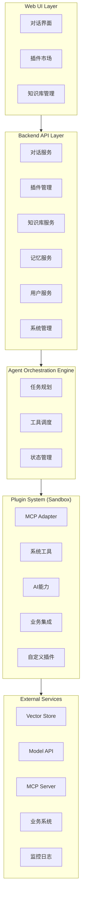
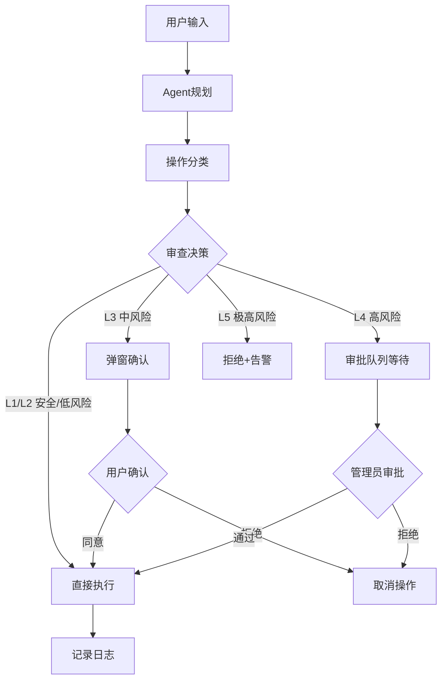
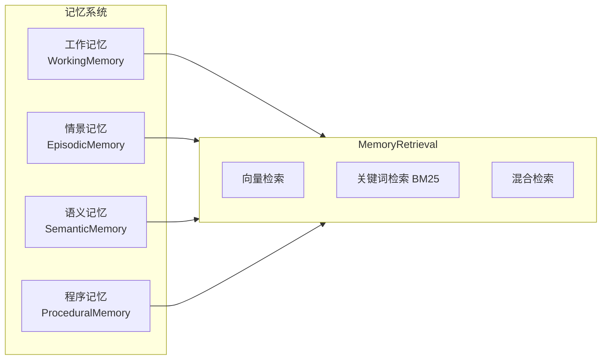

## 1. 高层摘要 (TL;DR)

*   **影响范围：** 🟢 **高** - 这是一个全新的产品需求与架构文档，定义了"小智 XiaoZhi"插件化AI助手平台的完整技术蓝图。
*   **核心变更：** 新增一份571行的综合性文档，涵盖产品定位、功能需求、技术架构、数据模型等完整规格说明。

### 📌 关键变更点
*   ✨ **产品定位**：定义了插件化Web版AI助手平台，支持多协议（MCP、A2A）和领域适配
*   🏗️ **架构设计**：五层架构（Web UI → Backend API → Agent编排引擎 → 插件系统 → 外部服务）
*   🔌 **插件系统**：支持MCP/A2A协议适配、沙箱隔离、操作审查机制
*   🧠 **记忆与知识**：多层次记忆管理 + RAG增强检索系统
*   🛡️ **安全机制**：五级操作审查策略（L1-L5风险分级）

---

## 2. 可视化概览 (代码与逻辑映射)

### 2.1 系统架构图



### 2.2 操作审查流程



### 2.3 记忆系统架构



---

## 3. 详细变更分析

### 📁 组件：产品定位与设计原则

**变更内容：** 定义了产品的核心定位、目标用户群体和用户体验设计原则。

| 设计原则 | 描述 | 具体要求 |
|---------|------|---------|
| 零/低学习成本 | 用户开箱即用 | 90%功能3步内可达；智能提示覆盖全流程 |
| UI简洁明了 | 界面清爽，信息层次清晰 | 核心对话为主；插件按场景自动分组 |
| 功能通俗易懂 | 功能命名清晰 | 使用用户语言；图标+文字双重标识 |
| 渐进式复杂度 | 基础用户简单，高级用户强大 | 专家/新手模式切换；提供模板和预设 |

---

### 📁 组件：核心功能模块

**变更内容：** 定义了六大核心功能模块及其优先级。

#### 功能模块优先级表

| 模块 | 功能点 | 优先级 |
|------|--------|--------|
| **AI对话引擎** | 多模型接入、对话管理、流式输出、工作区管理、文件索引、上下文操作建议 | P0 |
| **智能体管理** | 快速创建智能体、智能体配置、智能体对话 | P0 |
| **插件系统** | 插件市场、MCP/A2A协议、操作审查机制、沙箱执行配置 | P0 |
| **记忆系统** | 短时记忆、长时记忆、记忆分层、向量检索 | P0/P1 |
| **知识库系统** | 文档上传、向量化、RAG检索、知识管理 | P0/P1 |
| **Agent编排引擎** | 任务规划、工具调用、操作审查、任务拆分评估、评分选择机制 | P0/P1 |

#### 插件类型支持

| 类型 | 功能示例 |
|------|---------|
| 系统工具类 | 文件处理、Shell命令执行、代码执行、API HTTP调用 |
| AI能力类 | 外部模型接入、Embedding服务、TTS/ASR语音服务 |
| 业务系统集成类 | 数据库操作、CRM/ERP集成、自定义业务API插件 |

---

### 📁 组件：技术架构

**变更内容：** 定义了完整的技术栈选型和核心模块设计。

#### 技术栈选型表

| 层级 | 技术选型 | 说明 |
|------|----------|------|
| 前端 | React 18 + TypeScript | 组件化开发，支持插件化UI扩展 |
| 前端状态 | Zustand / Jotai | 轻量级状态管理 |
| UI组件 | TailwindCSS + Radix UI | 现代化UI |
| 后端 | Node.js (NestJS) / Go | 高并发、支持插件沙箱 |
| 数据库 | PostgreSQL + Redis | 主数据 + 缓存 |
| 向量库 | PostgreSQL pgvector / Milvus | 向量存储与检索 |
| 插件沙箱 | Docker / WebContainer | 插件隔离运行 |
| 消息队列 | Kafka / Redis Stream | 异步任务、事件驱动 |
| 容器编排 | Kubernetes | 可扩展、高可用 |

---

### 📁 组件：操作审查机制

**变更内容：** 定义了类似Claude Code的五级操作审查策略。

#### 操作分级策略表

| 级别 | 操作类型 | 示例 | 处理方式 |
|------|----------|------|----------|
| L1 - 安全 | 只读操作 | 读取文件、搜索内容、查看目录 | 直接执行，无需确认 |
| L2 - 低风险 | 无破坏性写操作 | 创建新文件、生成代码、编辑已有内容 | 直接执行，事后记录 |
| L3 - 中风险 | 有潜在影响的操作 | 修改配置文件、执行测试 | 执行前用户确认 |
| L4 - 高风险 | 不可逆/危险操作 | 删除文件、执行生产命令、发布代码 | 执行前用户明确审批 |
| L5 - 极高风险 | 系统级危险操作 | rm -rf、系统命令、数据库写操作 | 完全禁止，需管理员介入 |

---

### 📁 组件：任务拆分评估机制

**变更内容：** 定义了复杂任务的拆分评估与方案评分选择机制。

#### 评估维度表

| 维度 | 权重 | 说明 |
|------|------|------|
| 可行性 | 30% | 子任务是否可执行（工具支持、权限足够） |
| 成本 | 25% | Token消耗、时间估计、资源使用 |
| 准确性 | 25% | 与原始目标的匹配度 |
| 效率 | 20% | 执行路径最短、步骤最少 |

#### 方案评分示例

| 方案 | 可行性 | 成本 | 准确性 | 效率 | 总分 | 决策 |
|------|--------|------|--------|------|------|------|
| A: 全量代码扫描 | 95 | 40 | 90 | 30 | 66 | 备选 |
| B: 重点模块分析 | 95 | 70 | 95 | 70 | **84** | **最优** |
| C: 只看README | 100 | 90 | 60 | 95 | 83 | 备选 |

---

### 📁 组件：数据模型

**变更内容：** 定义了插件和记忆实体的TypeScript接口结构。

```typescript
// 插件实体
interface Plugin {
  id: string;
  name: string;
  version: string;
  type: 'system' | 'ai' | 'business' | 'custom';
  protocol: 'mcp' | 'a2a' | 'native';
  manifest: PluginManifest;
  permissions: Permission[];
  status: 'enabled' | 'disabled' | 'installed';
  createdAt: Date;
  updatedAt: Date;
}

// 记忆实体
interface Memory {
  id: string;
  userId: string;
  // ... 其他字段
}
```

---

## 4. 影响与风险评估

### ⚠️ 潜在风险

| 风险类型 | 描述 | 建议措施 |
|---------|------|---------|
| **架构复杂度** | 五层架构+多协议支持，实现难度较高 | 建议分阶段迭代，P0功能优先 |
| **安全风险** | 插件沙箱隔离、操作审查机制需要严格测试 | 安全审计、渗透测试 |
| **性能风险** | RAG检索、向量存储可能成为性能瓶颈 | 缓存策略、索引优化 |
| **用户体验** | 功能丰富但需保持简洁易用 | 用户测试、迭代优化 |

### 🧪 测试建议

1. **功能测试**：验证P0优先级功能是否满足需求
2. **安全测试**：验证L4/L5级操作审查机制的有效性
3. **性能测试**：测试RAG检索在大规模文档下的响应时间
4. **兼容性测试**：验证MCP/A2A协议适配器的兼容性
5. **用户体验测试**：验证"90%功能3步内可达"的设计目标

### 📋 后续工作建议

- [ ] 细化API接口文档
- [ ] 补充数据库Schema设计
- [ ] 定义插件开发规范
- [ ] 制定部署架构方案
- [ ] 补充监控告警方案

---

**文档来源：** `ai问答/插件式AI助手平台需求及架构文档.md` (新增文件，571行)

---

## 5. 后端技术评估

详见 [后端技术评估文档](./后端技术评估文档.md)

### 评估结论

| 评估项 | 结论 |
|--------|------|
| **前端技术选型** | React 18 + TypeScript + Zustand + TailwindCSS + Radix UI |
| **后端技术选型** | Node.js (NestJS) + vm2沙箱 + pgvector（插件化） |
| **总体可行性** | 很高 |
| **前端第一阶段** | 2-3周完成P0核心框架 |
| **后端第一阶段** | 4-5周完成P0核心功能 |
| **主要风险** | 前端：插件化UI架构；后端：MCP协议实现 |